# Character Studio

**An AI-assisted video game character creation studio.** The goal is to help game developers turn character assets into animated, reusable characters through a local workflow for preparation, rigging, natural-language motion generation, visual animation graphs, and export.

The implementation combines **staged character design and existing humanoid FBX assets with AI-generated body motion**. Artists retain control over reference review, body and hand fitting, wrist/finger poses, motion instructions, and the final exported character. Designer supports geometry-only and textured generation; neither produces a finished, rigged game asset.

Local-first Windows ARM64 desktop app with **Designer** and **Animator** workspaces. Designer turns a character brief or local reference image into a scene concept, a T-pose reference, and a GLB model, with optional textures. Built-in inference stays local; [per-stage providers](#model-and-workflow-providers) can use custom workflows, explicitly approved remote GPU servers, or paid Tripo APIs. Animator imports humanoid meshes, fits and skins a body rig, generates compatible Kimodo motion through the selected provider, and exports the **animated character mesh** using local Blender.

## Features at a glance

| Feature | What you can do |
|---|---|
| [First-launch setup checklist](#first-launch-setup-checklist) | On first launch, see what this PC already has and what Designer and Animator still need. A missing Blender is [installed automatically](#blender-is-installed-automatically-when-needed) from a checksum-verified archive, with Cancel. One-click actions connect and start ComfyUI, download pinned and verified Designer weights, and open the right pages for gated or manual steps. Later launches [validate dependencies](#dependency-check-on-later-launches) and prompt you to fix problems such as a stopped ComfyUI. |
| [Staged character design](#designer-workflow) | Describe a character, scenario, and art style, or condition a concept with a local reference image. Review each scene, transparent T-pose, and GLB before continuing. |
| [Textured models](#local-textured-models) | Select native TRELLIS.2 to generate geometry and embedded base-color/metallic/roughness textures together from the T-pose, with selectable shape detail, texture size and face count. Hunyuan remains the lower-memory geometry-only option. |
| [External inputs](#start-from-external-inputs) | Skip ahead with an existing T-pose or embedded GLB instead of regenerating earlier stages. Scenes are always generated from a description or a reference photo plus description. Preserve originals and distinguish imported artifacts from generated results. |
| [Local model profiles](#offline-models-and-memory-profiles) | Choose installed weights or use **Download required models** on supported missing-model warnings. Approve the download, then Studio verifies and selects the files for local inference. GPU-memory checks still apply; optional IP-Adapter and Ollama naming need separate setup. |
| [Model & workflow providers](#model-and-workflow-providers) | Choose hardware-fit local presets, custom checkpoints/mapped ComfyUI workflows, or remote ComfyUI/API routes per AI stage. Separate T-pose editing from cutout removal. Keep keys OS-encrypted and provider/workflow provenance with outputs. |
| [Paid Tripo integration](#tripo-paid-api) | Use your own API key and credits for hosted Nano Banana or GPT Image models, Tripo H3 mesh generation with triangle budgets/Smart low-poly, and separate PBR/rigged GLB variations. These adapters have contract/desktop fixture coverage, not a verified paid end-to-end run. |
| [Guided humanoid rigging](#animator-workflow) | Import FBX assets or send Designer meshes to Animator. Joint landmarks are [automatically fitted to the mesh](#automatic-landmark-fitting) on import; review and adjust them and the orientation with mirrored editing. Then build a Blender-skinned body rig with automatic missing-weight repair, or explicitly accept your points with approximate fallback skinning. |
| [Configurable hand rigging](#hand-pose-and-rig-detail) | Choose wrist-only or guided three-chain hands independently per side. Pose thumb, index and grouped fingers; key opening/closing over body motion; or bake a fixed grip into a separate wrist-only character. Preview and exports share the pose math; completed takes remain unchanged. |
| [Natural-language animation](#animator-workflow) | Generate motion takes with duration, seed, denoising steps, and in-place controls. Branch from a completed take's actual endpoint; preview with playback, scrubbing, orbit, zoom, and wireframe. |
| [Motion encoder choice](#experimental-lfm-setup-no-llama-approval) | Use the original local Llama/LLM2Vec encoder or explicitly select the experimental ungated LFM bridge. Readiness checks and GPU guidance surface setup requirements without silently switching models. |
| [Visual animation graphs](#visual-animation-graphs) | Connect states, reusable actions, transitions, and pose-constrained loops. Inspect path-specific incoming context, save layouts, and preview node clips, transitions, or full paths. |
| [Configurations and batches](#repeatability-and-collections) | Save or exchange configuration JSON, import FBX collections, and generate sequential batches with identical motion per path context or deterministic seed variations. Rerun immutable batch snapshots. |
| [Character exports](#animator-workflow) | Save animated skinned GLB, FBX, and editable Blender scenes, plus separately labeled motion-only BVH/NPZ. Export completed batch results with manifests; failed outputs are not presented as completed characters. |
| [Local workspace persistence](#data-and-reproducibility) | Keep original assets, designs, rig fits, settings, jobs, and outputs on this PC. Cancel app-owned work and retain completed results across restarts. |
| [Visible desktop MCP control](#desktop-mcp-control) | Let a trusted local agent operate the actual desktop window: Designer, Animator, fitting, graphs, batches, settings, import/export, playback and viewport gestures. Watch the same controls, progress and errors as when working manually. |

**Current boundaries:** Built-in Designer outputs are unrigged until prepared in Animator; optional remote rigged GLBs are exportable but not guaranteed compatible with its SOMA body rig. Native Hunyuan outputs are untextured; inferred textures cannot guarantee accurate unseen surfaces or seam-free UVs. Animator rigging is guided and body-only, not universal auto-rigging; automatic landmark fitting is a heuristic for standing T- or A-pose humanoids and needs review. Motion and graph joins require review; endpoint checks do not guarantee seamless animation or game-engine readiness. Local models/backend setup or separately configured remote services are prerequisites, not bundled capabilities. Part segmentation, learned landmark inference and cloth analysis remain future extension points.

## Screenshots

### App identity and titlebar

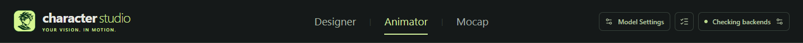

The green avatar artwork is used for the desktop window and packaged Windows application. The in-app titlebar displays it at 48px so the character silhouette stays recognizable.

### Setup checklist on first launch

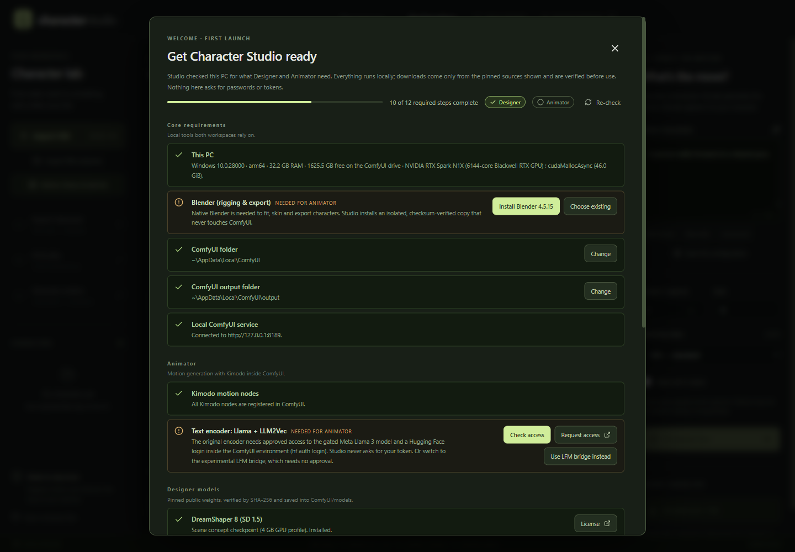

A real first launch against a fresh workspace on the development PC. Items already present show as complete; the remaining steps have one-click actions. Readiness checks confirm prerequisites, not successful generation.

### Dependency check on a later launch

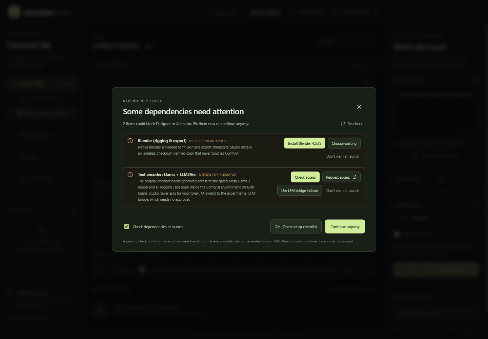

A real later launch on the development PC, in a fresh workspace without Blender and with the Llama encoder not yet approved. ComfyUI was already running there, so it is not listed.

### Designer: character concept and transparent T-pose

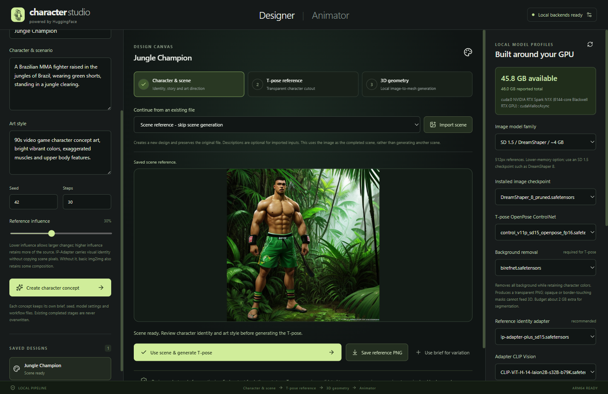

Review the character-and-scene concept before generating the next reference. This capture predates moving file imports to the T-pose and 3D steps; step 1 no longer shows **Continue from an existing file**.

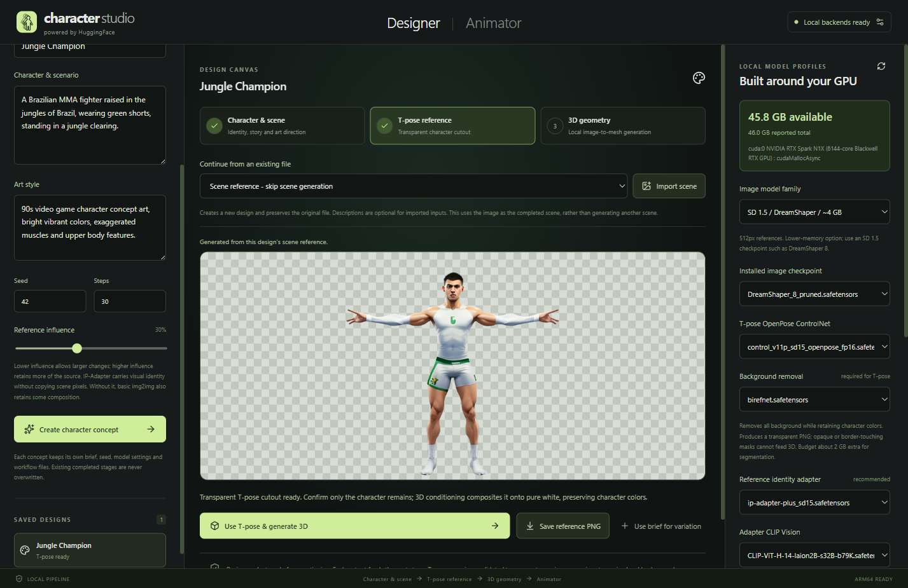

This real FLUX.2 klein edit retained the scene's green shorts, wrist wraps, ankle wraps and sandals, followed by BiRefNet isolation. The checkerboard previews transparency and is not saved into the image. These captures predate the additional flat-hand/fingers-together instruction and the latest header styling. The arms are below a strict horizontal T-pose; review pose and anatomy rather than assuming exact preservation.

### Designer: untextured 3D geometry

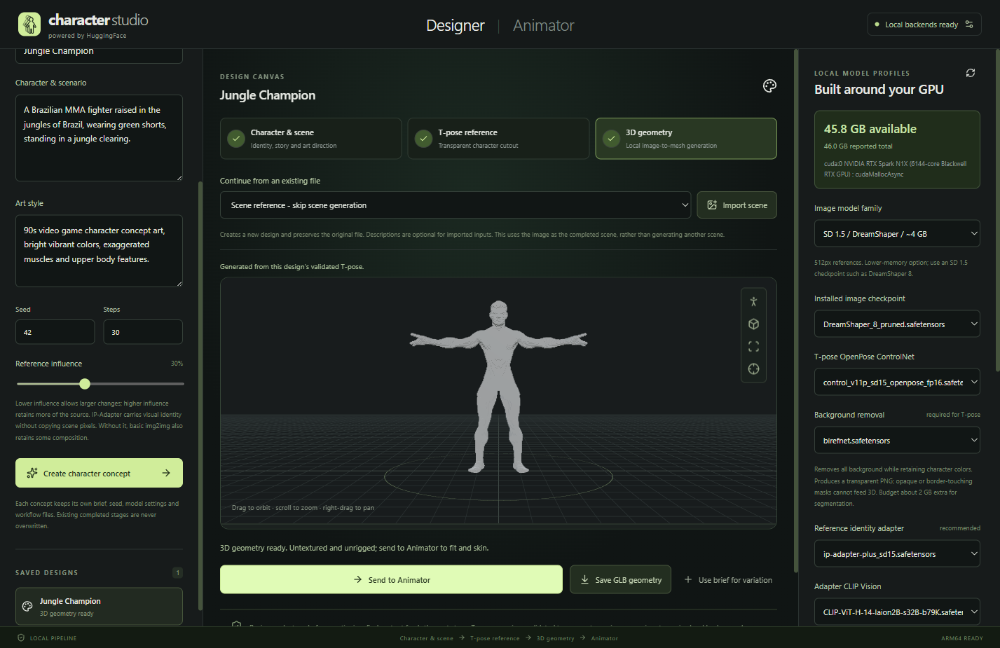

The saved local run produced a Hunyuan3D mesh from the isolated T-pose. Preview or save the GLB, then send it to Animator for fitting and skinning. This is geometry, not a textured, rigged, production-ready character.

### Designer: locally generated textured model

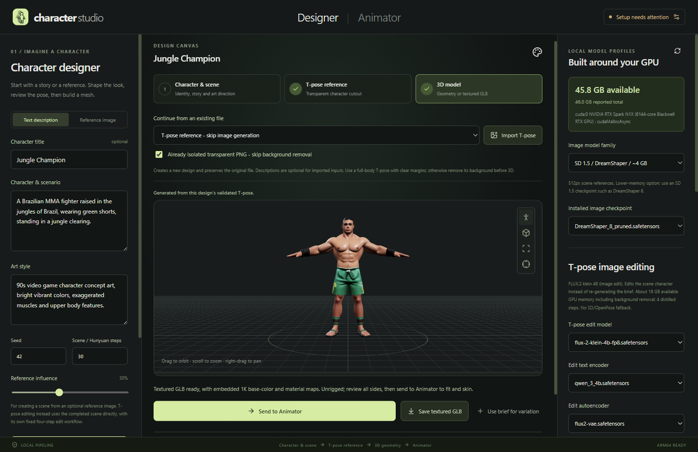

Actual local TRELLIS.2 generation from the edited cutout above, imported as the starting T-pose for this run. The mesh was remeshed and UV-unwrapped before baking 1K color and metallic/roughness maps. Color and material maps survived GLB export and Blender/Animator import. This is still an unrigged character; inferred surfaces and anatomy need review.

### Character lab and guided rig fitting


The textured Designer mesh has been handed off to Animator through Blender, retaining its material maps. Adjust humanoid joint landmarks before building the skin and rig; this screenshot shows fitting, not a completed rig or generated animation.

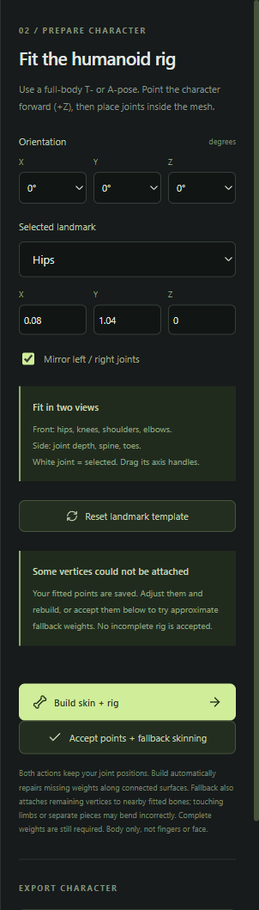

Actual desktop controls captured with a simulated skinning failure in an isolated UI test workspace. This illustrates point acceptance and recovery actions, not successful repair of a user character or motion quality.

### Animator: learned motion preview

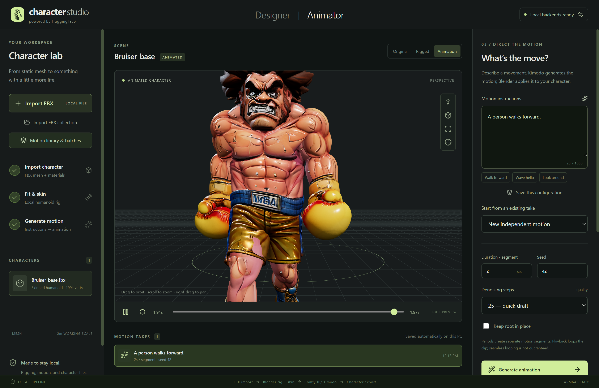

This saved desktop run used the experimental local LFM bridge and produced a learned walking take with character exports, not an analytic motion fixture. A still image does not establish motion quality, seamless looping, or constrained-graph success. The imported sample character asset is not included in this repository.

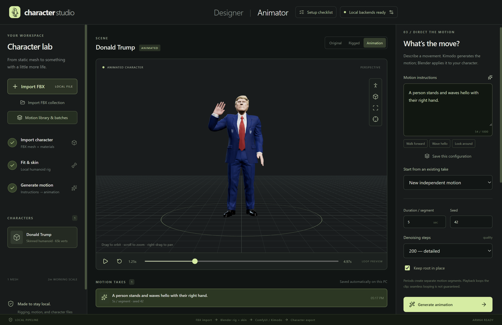

End-to-end local run: a Designer-generated TRELLIS.2 mesh (about 65,000 vertices) was sent to Animator, fitted, skinned with **Build skin + rig**, and animated with the **Wave hello** preset using the experimental LFM bridge. In the exported GLB, the raised right hand moves side to side for most of the 5-second take; the full-character GLB and FBX exports contain the textured skinned mesh. This historical body-only rig has no finger bones, so the hand stays rigid; it predates the optional Basic hand rig. This is one observed take, not a guarantee of handedness or motion quality for other prompts or seeds.

### Visual animation graphs


Arrange reusable states and actions, connect transitions, and edit motion instructions and generation settings. This graph-editor screenshot predates the Designer workspace; it illustrates graph authoring, not successful learned graph generation.

### MCP: agent control of the visible desktop

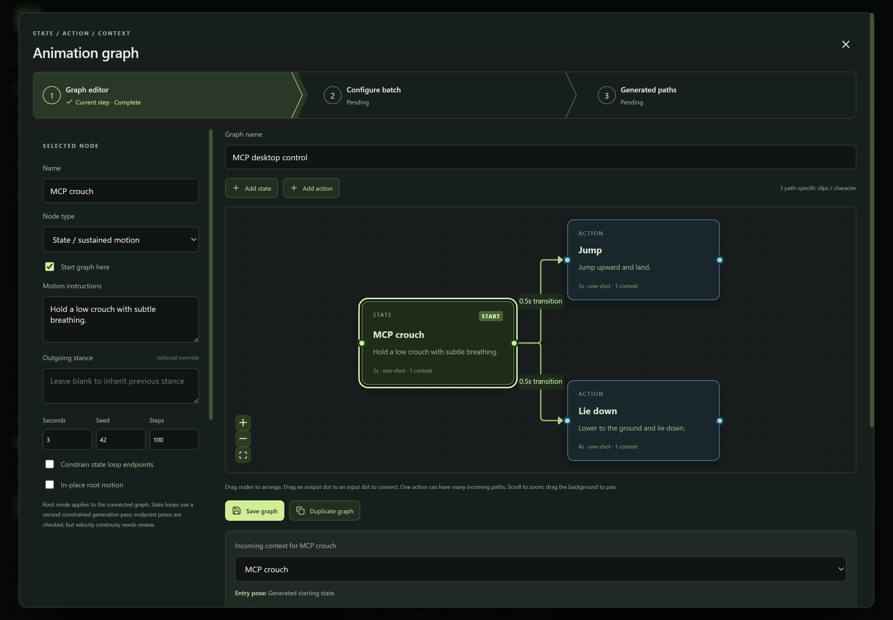

The MCP smoke run used the real stdio client and desktop UI to author, move, save, export and reimport this graph. This is graph authoring without a character or learned generation, not evidence of rigging, inference or motion quality.

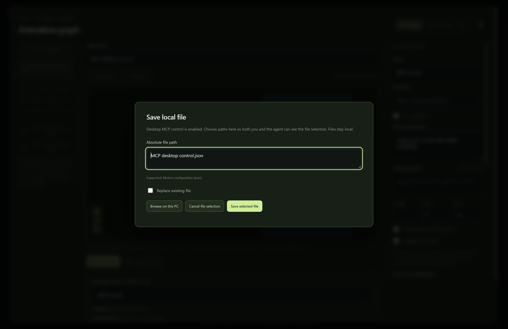

The same desktop export action opens an in-app file picker an agent can operate while the user watches. The initial suggested filename is shown before choosing a destination; no private path or credential is included.

## Launch

Open `release\CharacterStudio-win32-arm64\CharacterStudio.exe`, or run `Start-CharacterStudio.ps1`. The old `Start-KimodoStudio.ps1` launcher forwards to the new launcher for compatibility. Kimodo remains the name of the local motion-generation backend.

Keep the portable folder together; its executable depends on the included runtime files. Native Blender and the Python backend scripts are deliberately unpacked rather than placed inside an Electron archive.

For development:

```powershell
npm install
npm run setup:blender
npm run dev
```

`npm run build` builds the app; `npm start` launches that build. `npm run package` creates a portable application for the current OS and CPU architecture, including the isolated Blender runtime installed by `npm run setup:blender`. Windows ARM64 keeps the existing `release\CharacterStudio-win32-arm64` layout. The PowerShell Blender setup launcher remains available for compatibility.

### First-launch setup checklist

The first time Studio opens with a new workspace, it shows **Get Character Studio ready**. Reopen it any time from the task-list icon button (**Setup checklist**) at the right of the top bar. Studio inspects this PC and groups what it finds:

| Group | Detected | One-click actions |
|---|---|---|
| Core requirements | OS, CPU, RAM, free disk space and GPU; Blender; ComfyUI folder (with `main.py` and its venv Python); output folder; whether the local ComfyUI API responds | **Install Blender 4.5.15** (official mirror archive, SHA-256 checked, extracted into the workspace `tools` folder and selected) or **Choose existing**; **Use this folder** for a detected ComfyUI install; **Use ComfyUI/output**; **Start ComfyUI** |
| Animator | Kimodo nodes registered in ComfyUI (or present under `custom_nodes`); the selected text encoder | **Open ComfyUI-Kimodo** (install guide); **Check access** runs the existing Llama preflight; **Request access**; **Use LFM bridge instead** runs `backend\setup_lfm.py` with ComfyUI's Python and selects LFM |
| Designer models | DreamShaper 8, FLUX.2 klein 4B fp8, Qwen3 4B text encoder, FLUX.2 VAE, BiRefNet and Hunyuan3D 2.0, either as exact files or as weights already chosen in Designer | **Download** one model (the button shows its size), or **Download all missing** (about 18.5 GB for all six); **License** opens each model's license page |
| Optional | A local Ollama service for character naming | **Get Ollama** |

Designer downloads are pinned to an immutable Hugging Face revision and an exact byte size and SHA-256. They stream to a `.part` file, are verified, and only then move into `ComfyUI\models`. Studio also checks free space first and deletes partial data on failure or **Cancel**. A downloaded model is selected in Designer only when that field is empty or still at its default; existing choices are kept. If a file at a pinned path has a different size, it is flagged. Only that row's **Download** replaces it, after the new copy is verified; **Download all missing** skips it. These downloads do not collect credentials; optional inference API keys belong only in the encrypted provider settings. Setup help pages come from a fixed allowlist in the main process.

**Limitations:** the checklist does not install ComfyUI, GPU drivers, PyTorch or custom nodes such as ComfyUI-Kimodo. Follow the linked guides, then select **Re-check**. TRELLIS.2 textured generation and the optional scene IP-Adapter are not part of the one-click downloads. The gated Llama encoder still needs approved access and a Hugging Face login inside the ComfyUI environment. The LFM bridge needs ComfyUI-Kimodo on disk and a ComfyUI restart. A completed checklist means the prerequisites were found, not that generation or export will succeed on this hardware. Clear **Show this checklist at launch** to stop it from opening automatically. Automation can set `STUDIO_SKIP_SETUP_CHECKLIST=1` to suppress the first-launch dialog.

#### Blender is installed automatically when needed

Animator needs Blender to import, fit, skin and export characters (Designer does not use it). Packaged builds already include an isolated Blender 4.5.15, so the checklist simply marks it done. If Studio's own Blender is missing—typically a development checkout that has not run `npm run setup:blender`, or a removed `tools` copy—the checklist explains this at the top and starts **Install Blender 4.5.15** on its own, with download progress and **Cancel** on the Blender row. The later-launch dependency check does the same when Blender is among the listed problems, unless you chose **Don't warn at launch** for it. The archive comes from mirror.blender.org (about 243 MB on Windows ARM64; allow about 2 GB free), is verified against a pinned SHA-256, extracted into the workspace `tools` folder and selected. It never touches ComfyUI or another Blender install.

Studio starts this automatically at most once per session: after a failure or **Cancel**, the row keeps **Install Blender 4.5.15** and **Choose existing** for you to retry. A Blender you chose yourself is never replaced automatically; if it stops starting, the row says so and offers both actions. Automation can set `STUDIO_NO_AUTO_INSTALL=1` to prevent automatic installs.

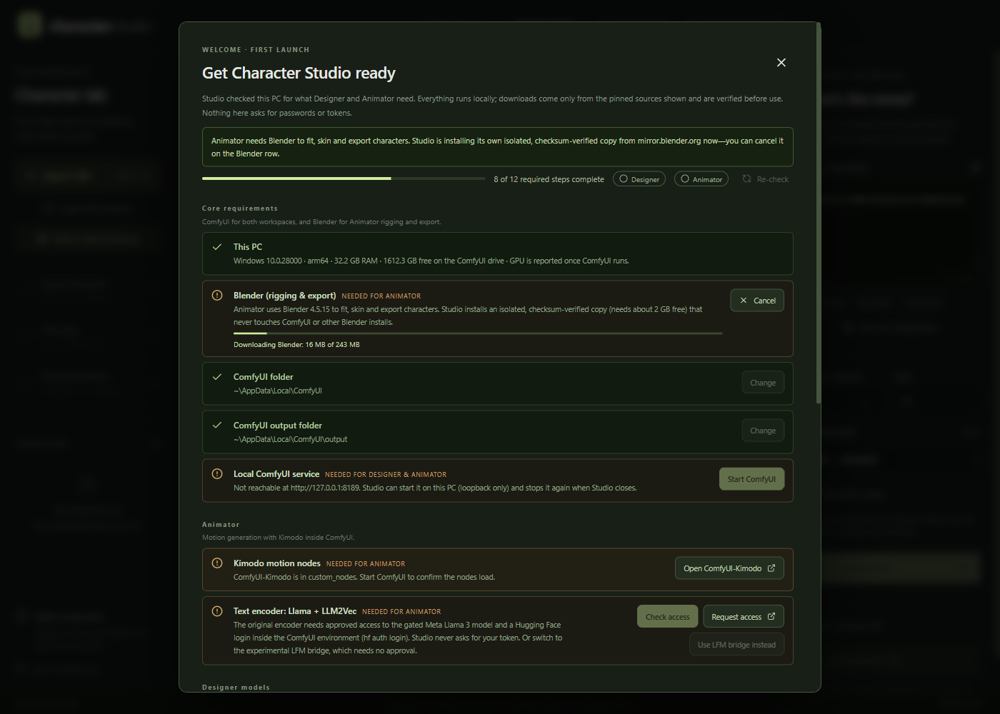

*A real first launch in a fresh workspace on a development checkout with its bundled Blender temporarily removed; the install was cancelled after the screenshot.*

#### Dependency check on later launches

After the first launch, Studio checks its dependencies each time it opens (unless **Show this checklist at launch** opens the full checklist instead). A small **Checking Blender, ComfyUI and models…** card appears in the corner while you keep working; select **Cancel** to stop the check. If every required item passes, a brief confirmation appears. If anything Designer or Animator needs is missing or not working, the **Some dependencies need attention** prompt lists only those items with the same one-click actions as the checklist, such as **Start ComfyUI** or **Install Blender 4.5.15**. The prompt re-checks after each action and offers **Re-check** (with **Cancel check**), **Open setup checklist** and **Continue anyway**. Optional items never interrupt a launch.

**Don't warn at launch** hides one item until it works again; afterwards a new failure is reported again. If several Designer models are missing, **Don't warn about Designer models** silences them together for Animator-only use. Clear **Check dependencies at launch** in the prompt, or **Otherwise, check dependencies at launch** in the checklist, to stop the check entirely. The check runs the same probes as the checklist, so it confirms prerequisites, not successful generation. `STUDIO_SKIP_SETUP_CHECKLIST=1` also suppresses it.

After `npm run build`, `npm run test:setup` opens the checklist for a fresh temporary workspace using this PC's real tools, then relaunches to exercise the dependency check and its **Cancel**. It intercepts external links and sets `STUDIO_NO_AUTO_INSTALL=1`, so it does not start downloads or installs.

### Automated builds and releases

The **Build and release** GitHub Actions workflow runs tests, type checking, app builds, and native packaging on pull requests, pushes to `main`, and manual runs. It downloads official Blender 4.5.15 archives, checks pinned SHA-256 hashes before extraction, runs Blender's native launch check, and retains the runtime's redistribution/license files. Only app output, production dependencies, Python backend scripts, this README, and the matching Blender runtime are packaged; models, credentials, local assets, and workspace data are excluded.

| Platform | CPU | Download | Launch after extraction |
|---|---|---|---|
| Windows | x64, ARM64 | `CharacterStudio-win32-<arch>.zip` | `CharacterStudio.exe` inside the portable folder |
| Linux | x64 | `CharacterStudio-linux-x64.tar.gz` | `./CharacterStudio` inside the portable folder |
| macOS | Apple Silicon ARM64 | `CharacterStudio-darwin-arm64.zip` | `CharacterStudio.app` |

Each successful build makes archives available as workflow artifacts for 14 days. To publish a release, update `package.json` and the lockfile's root version together, commit that change, then push a matching tag such as `v0.1.0`. Tag/version mismatches fail the build. The workflow publishes a GitHub release with all four archives and `SHA256SUMS.txt` only after every target succeeds and all uploads finish; interrupted uploads leave an unpublished draft. Remove an incomplete draft before rerunning the release job. Tags containing a prerelease suffix are marked as prereleases. Manual runs build artifacts but do not publish releases.

Local packaging uses `npm run setup:blender` followed by `npm run package`; `npm run package:app -- --platform=win32 --arch=arm64` packages an already-built app with an already-installed matching runtime. Available targets are the four combinations above; Intel macOS (`darwin-x64`) is not supported. Linux builds need native Blender libraries (the workflow installs these); macOS runtime extraction uses `hdiutil` and `ditto`.

**Release limitations:** Windows and macOS apps are unsigned, and macOS apps are not notarized. Code-signing credentials are not collected or required by this workflow. These are portable archives, not installers or automatic updates. Windows ARM64 remains the locally exercised workflow; Linux and macOS packaging does not establish full rigging, inference, or export compatibility. On those platforms, ComfyUI defaults to `~/ComfyUI` and requires an existing `venv/bin/python`; select the actual backend/output folders in **Backend connections**. On Windows, the existing `%LOCALAPPDATA%\ComfyUI` and `venv\Scripts\python.exe` defaults remain unchanged. ComfyUI, GPU drivers, custom nodes, and model weights must still be configured separately; Windows-specific LFM setup and integration scripts are not made cross-platform by these releases.

## Desktop MCP control

The app includes an **opt-in local MCP server** that controls the running desktop, not a headless copy of Studio. It uses the existing React controls, Electron bridge, validation, job queue and persistence. Manual edits and agent edits affect the same window and workspace. All application workflows are reachable through the UI tools below; there is deliberately no second set of backend-only generation/import/export handlers.

### Start and connect

Open **Backend connections** and turn on **Enable MCP control**. New workspaces default to off. The toggle starts or stops the listener immediately, saves the choice independently of backend settings, and stays available during running jobs. Disabling disconnects clients and removes their connection file without cancelling work; re-enabling creates a fresh endpoint/token and requires clients to reconnect. The header has no MCP subtitle.

Start the app normally and use that toggle, or use the optional command-line override:

```powershell
npm run build
npm start
# Optional: enable MCP for this launch without first opening settings.
npm run start:mcp
# Or, for the Windows ARM64 portable distribution:
& ".\release\CharacterStudio-win32-arm64\CharacterStudio.exe" --mcp
```

For development, use `npm run dev` and the in-app toggle, or `npm run dev:mcp`. The MCP scripts pass `--mcp` through electron-vite's argument separator to Electron; the flag enables MCP for that launch even if the saved preference is off. Close an existing instance before using the flag, or just change its in-app toggle instead. **Backend connections** shows the live enabled/disabled status.

When enabled, a random-port HTTP listener binds only to `127.0.0.1`; its fresh bearer token and endpoint are written to `mcp-connection.json` in the current Studio data directory. On Windows this is `%APPDATA%\KimodoStudio`. The saved toggle lives in `mcp-settings.json`; neither file is packaged or tracked in Git. A custom `STUDIO_DATA_DIR` changes workspace, preference and connection-file locations. The connection file is removed on shutdown, but the toggle preference survives. Restarting an enabled app rotates the endpoint/token, so restart connected MCP clients too.

Configure a trusted MCP host with this **stdio** server entry, replacing the example path with this checkout's absolute path. Node.js 22+ must be installed separately, including for portable builds. The client attaches to an already-running desktop; it never launches or hides one.

```json
{
  "mcpServers": {
    "character-studio": {
      "command": "node",
      "args": ["C:\\path\\to\\CharacterStudio\\scripts\\mcp-client.mjs"]
    }
  }
}
```

For a portable distribution, point `args` to `scripts\mcp-client.mjs` under its `resources\app` folder (on macOS, `CharacterStudio.app\Contents\Resources\app`). The packaged client includes its MCP SDK dependency. For a custom workspace, append `"--connection", "C:\\path\\to\\data\\mcp-connection.json"` to `args`. The development shortcut is `npm run mcp -- --connection <absolute-path>`, but configure MCP hosts with `node` directly so npm's console banners do not corrupt stdio. Hosts supporting Streamable HTTP can instead use the exact URL and `Authorization: Bearer <token>` from the connection file; do not copy the token into committed configuration.

### Tools and workflow coverage

| Tool | Visible desktop operation |
|---|---|
| `studio_get_ui` | Read current text, alerts, modal, control labels, element refs, enabled states, values, dropdown options, and CSS-pixel bounds. Hidden workspace controls are excluded. |
| `studio_get_state` | Read persisted settings, designs/references, characters/rig setups, jobs, plans and batches to track asynchronous work. Does not mutate UI or run workflows. |
| `studio_click` | Activate a visible enabled control: switch workspace, select designs/characters/takes, create/run/cancel design or motion work, hand a mesh to Animator, build/save/reset a fit, pose hands, bake fixed grips, refresh readiness, save settings, start ComfyUI, edit/save/apply graphs, run/rerun/cancel/export batches, open import/export dialogs, and use viewport/playback buttons. |
| `studio_set_value` | Edit briefs/style, sampling, prompts, numeric joint coordinates, hand detail/radii/wrist/finger controls and key preview time, node/graph/transition fields, backend paths, file paths and playback ranges through their actual input handlers. |
| `studio_select` | Choose returned option values for model profiles/weights/encoder, rotation/joint, branch parent, node type, incoming context, connection destination and batch seed variation. |
| `studio_set_checked` | Set mirrored fitting, isolated T-pose, in-place motion, state looping/entry, batch targets/auto-rig, explicit file overwrite, and the MCP enable toggle (disabling it disconnects the agent). |
| `studio_press_key` | Focus a returned element and send a single character or navigation key, optionally with Shift/Control/Alt/Meta. |
| `studio_pointer` | Click, double-click, move or drag within the app: orbit/pan 3D, drag joint gizmos, arrange graph nodes, connect handles, select edges. Coordinates are CSS pixels from `studio_get_ui`; drag accepts a path of points. |
| `studio_scroll` | Scroll a returned panel ref to reach additional controls. |
| `studio_wheel` | Send a wheel event at a CSS-pixel point for 3D/graph zoom or ordinary panel scrolling. |
| `studio_screenshot` | Return the current app content as an MCP PNG image, including canvases and the visible file picker. |
| `studio_show_window` | Restore/show the actual desktop so the user can watch. |

Start with `studio_get_ui`, then pass an element's returned `ref` to an action. Re-inspect after navigation, modal changes or asynchronous updates; do not invent refs. For example, click the **Designer** tab, fill **Character title**, **Character & scenario** and **Art style**, then click **Create character concept** when enabled. The visible app updates exactly as for manual input. Disabled prerequisites and modal boundaries are enforced rather than bypassed.

With MCP enabled, app file pickers appear as **visible in-app dialogs**. Fill the absolute local file/folder path (one path per line for collections) and click **Use selected paths** or **Save selected file**. The main process checks existing files/folders, supported extensions, collection limits and destination parents before using the existing import/export validation. Overwriting an existing export requires the visible **Replace existing file** checkbox. **Cancel file selection** leaves the existing workflow unchanged. A person can still use **Browse on this PC** for a native picker; the MCP tools do not control that separate OS window. With MCP disabled, new file selections use the normal native dialogs.

Generation, rigging, readiness checks and batch work remain asynchronous. An action result means the control was activated, **not** that the work succeeded. Poll `studio_get_state` and re-inspect visible progress/errors; use the existing **Cancel**/**Cancel design** controls when needed. Requirements follow the selected provider; local Blender and motion-processing prerequisites still apply.

Provider settings, workflow JSON import and the **Approve remote AI execution** dialog use these same UI primitives. `studio_set_value` can fill the write-only API-key password field, but inspection never returns its value. Only give an agent a credential if you trust its conversation/tool history as well as Studio's vault. MCP can operate the visible remote-approval and paid-credit controls: enabling MCP delegates that authority to the trusted agent, not just local file access.

### Trust and limits

Enable this only for agents you trust with **all of the app's local user privileges**: importing local assets, changing backend paths, starting app-owned work, exporting/overwriting selected files, opening the app's fixed external help/download links, and viewing assets/paths in snapshots and screenshots. Loopback is not a sandbox or a per-tool permission system. The bearer file is owner-only on POSIX; on Windows it inherits the data folder's ACL, so keep that folder private. Never publish the connection file or token, forward its port, or expose it through a proxy. Requests require the exact loopback Host and bearer token; browser Origin headers are rejected. Tool arguments are schema-validated. No arbitrary JavaScript, shell, private IPC or general filesystem tools are exposed; Electron context isolation and sandboxing remain enabled.

The server controls **Studio's window only**, not the OS, external browser pages, authentication prompts, ComfyUI's separate UI, or other desktop applications. Model access, downloads and third-party authentication remain subject to the existing manual setup guidance. The user can continue interacting with the same window; coordinate edits to avoid conflicting selections. Turn off **Enable MCP control** to revoke access immediately, including when launched with `--mcp`. A stale connection file after a crash is not a running server; restart Studio rather than reusing its token.

`npm run test:mcp` builds and exercises the real stdio-to-HTTP-to-Electron path in an isolated workspace under ignored `artifacts\mcp-smoke`: visible Designer fields and cancellation, graph edits and dragging, save/import/export with overwrite checks, backend settings and folder selection, stale refs, keyboard/scrolling, screenshots, in-app disable/re-enable with revoked credentials, saved-toggle restoration, cleanup and a default-off launch. It also runs generation-rerun and provider regressions in temporary workspaces with deterministic local HTTP fixtures. A landmark auto-fit regression on procedural box meshes checks that **Auto-fit landmarks to mesh** updates the visible joint fields without saving, **Save fit without rigging** persists them, and a non-humanoid block reports an error and keeps its landmarks. Hand coverage observes visible wrist/finger deformation, fitting controls, key scrubbing, graph overrides and immutable takes. It needs no model weights, Blender or third-party character. Provider credential coverage requires a working OS encryption backend. It does not establish successful learned generation, paid API interoperability, native rigging, motion quality, or cross-platform GUI compatibility. The separate `npm run test:hand-desktop` uses local Blender for actual fixed-grip baking and export.

## Model and workflow providers

Open **Backend connections > Model & workflow providers**, the same button in Designer, or a stage's Local/Remote badge. Existing installations default to the unchanged built-in local routes. Saving selections never starts generation.

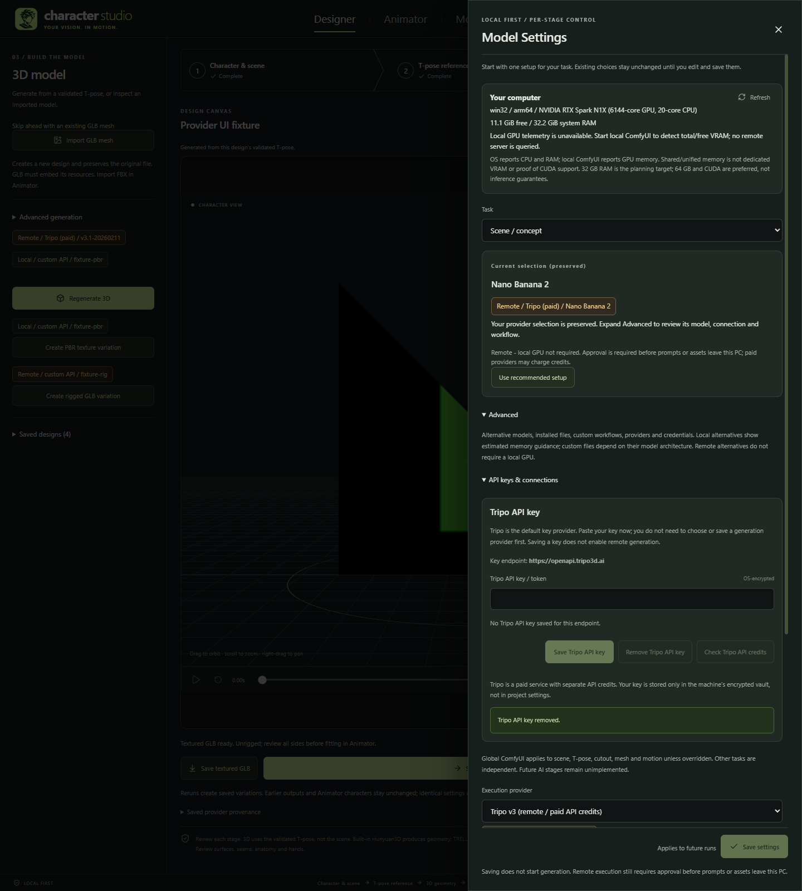

Actual desktop/MCP capture from an isolated fixture workspace. Local GPU telemetry was deliberately unavailable; no Tripo request or learned inference was performed.

Choose **AI stage**, then **Execution provider**. Naming, scene/concept, T-pose editing, background removal, mesh generation, PBR post-texturing, remote rigging and motion/text encoding are independently configurable. **Global ComfyUI connection** supplies a default for scene, T-pose, cutout, mesh and motion; an explicit stage override wins, including **Built-in local presets** to keep that stage local. Naming, post-texturing and rigging do not inherit the global connection. Future segmentation, landmark and cloth entries are disabled until those features exist.

**Built-in local presets** expose installed checkpoint names and the existing image/mesh/encoder profiles. The panel reports CPU, platform/architecture, RAM and local ComfyUI's total/free VRAM, with conservative per-profile guidance. Unknown telemetry is not proof of compatibility. Changing image architecture clears incompatible checkpoint/adapter choices; full VAE, vision, adapter and supported-download controls remain in Designer. No weights, precision or provider are silently switched to fit the machine.

**Local ComfyUI / custom workflow** and **Remote ComfyUI (opt-in)** accept an HTTP(S) server base URL, an optional installed model/checkpoint ID (including checkpoint subfolders), and optional mapped workflow JSON. Without a custom template, image/mesh routes reuse the selected native graph and model components on that server; a different architecture needs an appropriate custom graph. LoRAs belong in that graph. Local routes must be loopback. LAN hosts, tunnels and cloud servers require a Remote route. Local telemetry/VRAM checks never block a remote stage, and the setup checklist stops requiring unused local inference weights.

The **ComfyUI API URL** in Backend connections remains the separate loopback-only local infrastructure connection. It is still used for built-in presets, local setup, telemetry and Python processing. Configuring remote inference does not expose Studio's desktop MCP server or change its loopback-only policy.

### Remote approval, credentials and cancellation

Each remote stage pauses **before any prompt or input upload**. Its dialog identifies endpoint, model and transmitted data: prompts/settings, reference images, meshes/materials or actual incoming pose constraints. Choose **Approve this remote stage** to proceed or **Keep data local / cancel** to send nothing. Graphs and loops may require approval for multiple remote samples. Remote processing is subject to that service's privacy, retention, licensing and pricing; Studio cannot enforce its deletion policy.

**Tripo API key** appears first and defaults to the official `https://openapi.tripo3d.ai` endpoint. Paste your key and choose **Save Tripo API key** immediately, without selecting or saving a generation provider. Saving a key does not change local-first generation defaults, submit a job or query credits. Model changes at the same endpoint do not clear a key being entered. Selecting Tripo's official `.com` endpoint switches to a separate credential scope.

For custom ComfyUI or Studio API gateway endpoints, save the route first, enter **API key / bearer token**, then **Save encrypted credential**. Credentials are bound to the exact provider and normalized endpoint and encrypted with Electron `safeStorage`. No plaintext fallback is allowed when the OS keychain is unavailable (including Linux's `basic_text` backend). Keys require HTTPS, even on a LAN; a credential-free local service may use HTTP. **Remove Tripo API key** or **Remove credential** removes the selected saved key. Existing values are never sent back to the renderer or MCP inspection. Do not paste credentials in model IDs, URLs, prompts or workflow JSON; credential-shaped workflow fields are rejected, but arbitrary user text is not a comprehensive secret scanner.

Submissions are not automatically retried. Studio records task IDs and cancels only its own job where supported. Recent ComfyUI must preserve client-supplied `prompt_id` and support the per-job `/api/jobs/{id}/cancel` endpoint; no global interrupt is used for routed jobs. Gateways must implement job-specific cancellation. If cancellation cannot be confirmed, inspect the provider before retrying. Tripo cancellation stops waiting locally but submitted tasks can continue and incur charges. Partial or invalid results are never published as complete.

### Tripo paid API

Save your key in **Tripo API key**, then select **Tripo v3 (remote / paid API credits)** for the stages you want it to handle. **Check Tripo API credits** explicitly queries available and frozen API credits; a web subscription is not an included API balance. No key, credits or subscription is supplied by Studio.

Scene/T-pose selections include **Nano Banana**, **Nano Banana Pro**, **Nano Banana 2**, and **GPT Image 1/1.5/2**, using Tripo's **v3** IDs: `banana`, `banana_pro`, `banana2`, `chat_image_1`, `chat_image_1.5` and `chat_image_2`. Availability and prices depend on the account/service. Tripo lists GPT Image 1 as retired and schedules GPT Image 1.5 retirement for December 1, 2026; those legacy selections are retained for migration, not silently switched. Midjourney and FLUX.1 are not offered by this v3 integration: old selections fail before transmission and need a supported preset or a compatible Studio API gateway. Custom v3 IDs remain available; `seedream_v4` is text-only and cannot process references. Tripo image prompts are limited to 1,024 characters including Studio's instructions. T-pose editing is followed by the independently selected background-removal provider.

Presets show their friendly names; the editable **Provider model / checkpoint ID** appears only after selecting **Custom model ID (advanced)**. For example, **Nano Banana 2** uses `banana2`. Previously saved Gemini/GPT IDs are recognized as aliases and translated for new Tripo requests: `gemini_3.1_flash_image_preview` becomes `banana2`, and `gpt_image_1.5` becomes `chat_image_1.5`. This fixes v3's `HTTP 400; code 1004` rejection of legacy IDs without changing the chosen model. Existing saved records are not rewritten; new approval requests and provenance use the actual v3 ID. Unknown saved IDs remain unchanged in Custom mode.

An HTTP 400 does not by itself identify the problem, even when credit lookup succeeds. Tripo failures now include its returned error code, message/suggestion and valid trace ID when available; credentials and URLs are redacted. Keep these details when reporting a failure. Studio does not retry a paid submission or substitute a model automatically. Matching mocked API contracts is not proof that a particular model/endpoint combination is accepted by the live service.

Mesh generation defaults to **Tripo H3 v3.1** (`v3.1-20260211`) with textured/PBR output. **This is not Tencent Hunyuan 3.1.** The latter requires a compatible custom ComfyUI graph or Studio API gateway; no native Tencent signing adapter is bundled. An existing generated/imported GLB exposes **Create PBR texture variation** and **Create rigged GLB variation** once those independent providers are configured. Each preserves the original mesh and creates a new design. A configured post-texturing route also follows new mesh generation. Tripo first uploads/imports the mesh, then starts texture/rig work; both task IDs are retained.

To reduce triangle count, open the mesh provider badge on Designer's **Model** step, or choose **Model & workflow providers > AI stage > 3D mesh generation**, and select **Tripo v3 (remote / paid API credits)**. Under **Triangle reduction**, set **Maximum triangles** (for example, `20000` or `50000`) and choose **Save provider selections**. This sends Tripo's `face_limit` for new mesh generations; it is a maximum, not an exact target. Leave it blank or choose **Use automatic triangle count** to restore Tripo's automatic density. Standard H3 limits are 1,500,000 for v3.1, 1,000,000 for v3.0 and 500,000 for v2.5; custom models may impose stricter limits.

**Smart low-poly** sends `smart_low_poly` to request simplified topology. When also specifying a triangle budget, use **500-20,000**; leaving the budget blank lets Tripo choose within its low-poly mode. Complex characters may fail or lose detail. H3 v2.5 and P1 do not support this switch. Invalid combinations are rejected rather than silently clamped. Both controls default to unchanged automatic density/Smart low-poly off, appear only for Tripo mesh generation, and remain locked during jobs. Selected values persist across restarts, appear in remote approval, and are retained in output provenance without modifying earlier designs. This does not simplify existing meshes, enable quad/FBX output, or guarantee deformation quality.

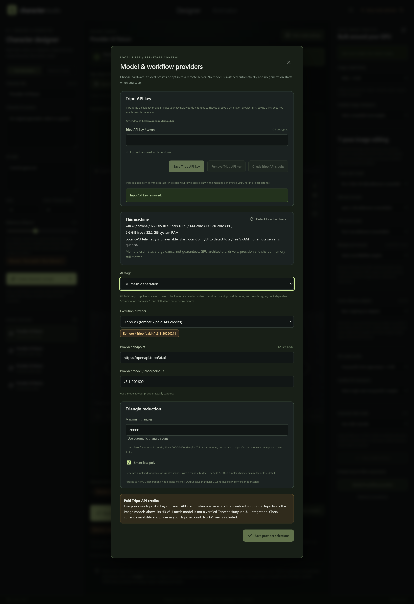

Actual desktop/MCP capture from an isolated fixture workspace. The fixture verifies settings, request fields, consent, locks and GLB handling, not learned mesh simplification or a paid end-to-end generation.

Image inputs are limited to 20 MB and mesh uploads to 50 MB. Returned models must be self-contained, supported GLB geometry with embedded resources; external assets or unsupported compressed geometry fail validation rather than appearing complete. PBR variation requires UVs, embedded base-color and metallic/roughness maps. Rig variation requires a skinned character mesh, not just a skeleton. **Send to Animator** still uses local Blender and its own guided SOMA body rig; imported remote rigs, deformation quality and engine compatibility are not guaranteed.

The native adapter follows the [Tripo v3 SDK/API reference](https://github.com/Tripo-Developer/tripo-python-sdk/blob/master/docs/API.md), the [v3 image-model constants](https://github.com/Tripo-Developer/tripo-js-sdk/blob/796ef86c358f8747f3cda507b282438ca02e3ead/src/constants.js), and [v3 H-series image-to-model documentation](https://developers.tripo3d.com/en/docs/generation-image-to-model/standard.md). The older advanced-image documentation uses different IDs and is not the v3 model contract. Studio uses `/v3/files`, generation/model/animation routes and `/v3/tasks`, not the retired v2 task API. Tests mock these contracts and exercise real local desktop output handling; **a paid end-to-end Tripo run has not been performed**.

### Custom ComfyUI workflow contract

Export **API-format** nodes from ComfyUI, wrap them in a Studio envelope and use **Import workflow JSON** or the JSON editor. Save mappings before changing stages. An ordinary ComfyUI editor-layout export alone is not sufficient. This complete text-only SD 1.5 scene example requires the named checkpoint installed on the chosen server:

```json
{
  "version": 1,
  "prompt": {
    "1": { "class_type": "CheckpointLoaderSimple", "inputs": { "ckpt_name": "DreamShaper_8_pruned.safetensors" } },
    "2": { "class_type": "CLIPTextEncode", "inputs": { "text": "", "clip": ["1", 1] } },
    "3": { "class_type": "CLIPTextEncode", "inputs": { "text": "text, watermark", "clip": ["1", 1] } },
    "4": { "class_type": "EmptyLatentImage", "inputs": { "width": 512, "height": 512, "batch_size": 1 } },
    "5": { "class_type": "KSampler", "inputs": { "model": ["1", 0], "positive": ["2", 0], "negative": ["3", 0], "latent_image": ["4", 0], "seed": 42, "steps": 20, "cfg": 7, "sampler_name": "euler", "scheduler": "normal", "denoise": 1 } },
    "6": { "class_type": "VAEDecode", "inputs": { "samples": ["5", 0], "vae": ["1", 2] } },
    "7": { "class_type": "SaveImage", "inputs": { "images": ["6", 0], "filename_prefix": "" } }
  },
  "bindings": [
    { "parameter": "prompt", "node": "2", "input": "text" },
    { "parameter": "seed", "node": "5", "input": "seed" },
    { "parameter": "steps", "node": "5", "input": "steps" },
    { "parameter": "prefix", "node": "7", "input": "filename_prefix" }
  ],
  "outputs": [{ "kind": "image", "node": "7", "field": "images" }]
}
```

This graph's checkpoint is fixed in its template; add a `model` binding to `1.ckpt_name` and fill **Provider model / checkpoint ID** to control it separately. Adding a reference photo requires an actual image-conditioning graph and `image` binding, not merely the scene text. Missing bindings or installed nodes are actionable errors.

Bindings assign supplied values directly into existing node inputs. Available parameters: `prompt`, `image`, `mesh`, `seed`, `steps`, `seconds`, `prefix`, `model`, `textEncoder`, `constraints`, `referenceStrength`. Image/mesh bindings receive uploaded server input filenames, never the client's local paths. Constraints are inline JSON strings. There is no script mapper. The envelope allows 1-300 nodes, up to 100 bindings, one of each output kind, and at most 1 MB.

| Stage | Required mappings | Required output kinds |
|---|---|---|
| Scene / naming | `prompt`, `prefix` (and `image` when a reference is supplied) | `image` / `text` respectively |
| T-pose / cutout / mesh | `image`, `prefix`; also bind `prompt` to apply editing instructions | `image` / `image` / `model` |
| Texture / rig | `mesh`, `prefix`; optional `prompt` for instructions | `model` |
| Motion | `prompt`, `seed`, `steps`, `seconds`, `prefix`, `constraints` | `npz`, `bvh`, `metadata` |

Each output mapping selects one history node/field containing a **one-element array**. Binary outputs must be `{ "filename": "studio_..._0001.png", "subfolder": "", "type": "output" }` descriptors using the bound job prefix plus `_` and the declared extension (`.png`, `.glb`, `.npz`, `.bvh`). Studio retrieves them through `/view`; no shared output directory is required. Text output is a nonempty title of at most 100 characters. Motion metadata is an object or JSON string with `num_joints: 77`, `num_frames`, and `fps`, matching the requested duration and segment count.

Local custom workflows reject declared ComfyUI API/cloud nodes and literal HTTP URLs. **Custom nodes are trusted software, not a sandbox or proof of offline execution**: a node or local API gateway can make its own network requests. Review installed nodes and gateway configuration yourself. Studio validates the selected routing boundary; it cannot audit server internals.

### Routed motion and text encoders

Remote/native ComfyUI motion needs ComfyUI-Kimodo and the matching selected Llama/LLM2Vec or experimental LFM loader on the server. Copy the repository's `backend\studio_provider_nodes` folder into that server's `ComfyUI\custom_nodes\studio_provider_nodes` and restart ComfyUI. The bridge adds `Studio_Kimodo_Sampler` and `Studio_MotionFile`; it does not install weights or replace backend packages.

Upstream `Kimodo_Sampler` interprets `constraints_json` as a **server-local filename**, silently ignoring inline JSON. The supplied sampler materializes inline constraints on that server before delegating; the output bridge exposes NPZ/BVH descriptors for HTTP download. Custom motion graphs must accept actual incoming/end-point constraints and return SOMA-77 NPZ/BVH plus metadata. Binding inline JSON directly to the upstream sampler is rejected. Different skeletons, ignored constraints, wrong frame counts and arbitrary motion formats are not supported substitutes.

The local machine still requires Blender, the configured ComfyUI Python environment's motion-processing dependencies and Kimodo source for safe NPZ loading, retargeting, branch/loop seam validation and skinned-character export. Remote inference does **not** require local inference weights, a running local ComfyUI server or local VRAM. Changing a model or encoder never discards incoming pose context. A saved batch refuses replay if its provider/model/workflow or encoder no longer matches.

### Studio API gateway v1

**Local Studio API gateway** / **Remote Studio API gateway (opt-in)** target this contract, **not arbitrary vendor REST endpoints**. Bring a gateway that implements the selected model, authentication and vendor-specific request/output conversion; Studio does not ship a gateway server. This is the extension point for otherwise unsupported image, Hunyuan, cutout or motion APIs. A local gateway that forwards data externally must be configured as **Remote**.

`POST {endpoint}/jobs` accepts:

```json
{
  "version": 1,
  "id": "client-generated-uuid",
  "stage": "tpose",
  "model": "your-model-id",
  "prompt": "editing instructions",
  "seed": 42,
  "steps": 20,
  "referenceStrength": 0.3,
  "inputs": [{ "kind": "image", "mimeType": "image/png", "base64": "..." }]
}
```

It must echo `{ "id": "client-generated-uuid" }` exactly and deduplicate that ID. Motion additionally supplies `seconds`, `textEncoder`, and `constraints` as the actual parsed pose-constraint JSON when conditioned. Mesh input uses `kind: "mesh"` and `mimeType: "model/gltf-binary"`. Text-only requests have an empty inputs array. A configured encrypted token is sent as `Authorization: Bearer ...`; redirects are refused.

`GET {endpoint}/jobs/{id}` returns `status` (`queued`, `running`, `complete`, `failed`, `cancelled`) and, only when complete, `outputs`. Return binary output bytes as standard padded base64 in `image`, `model`, `npz`, or `bvh`; naming uses `text`. Motion also requires `metadata: { "num_joints": 77, "num_frames": 60, "fps": 30 }` for a single two-second segment. Images must decode, cutouts must pass transparent-foreground validation, GLBs must contain embedded geometry/resources, and motion files undergo local verification. The combined JSON response limit is 700 MB; images are limited to 20 MB and each model/motion output to 500 MB. Polling stops after one hour.

`DELETE {endpoint}/jobs/{id}` must cancel **only that job** and return valid JSON, such as `{}`. Implement cancellation/deduplication in the gateway before using a billable backend. Missing/invalid outputs, failed requests and uncertain cancellation are errors, never triggers for a fallback model.

## Designer workflow

Switch to **Designer** in the top bar. The existing character lab remains in **Animator**; switching tabs preserves in-progress briefs, rig edits, and motion settings. These are two workspaces in one desktop app, not two competing inference services. Designer and Animator share one job slot to avoid GPU contention.

Select **Hide model settings** above the canvas to collapse the **Local model profiles** sidebar and give the preview more room; **Show model settings** restores it. Hiding keeps unsaved model choices and the current brief intact, including when switching workspaces. An **Unsaved** indicator remains on the toggle until you reopen the panel and **Save model choices**; generation still requires saved choices. The toggle works during generation and downloads without interrupting them. **Review model settings** on an error reopens the panel and focuses the relevant selector. The panel starts expanded on a fresh app launch.

The **Current step models** row follows the selected canvas step: scene generation shows only Scene; T-pose preparation shows T-pose and Cutout (only Cutout when an existing pose needs background removal); 3D shows mesh generation and any configured post-texturing provider. Rig/texture variation controls appear on the 3D step. Click a provider badge to edit that stage without being shown unrelated stage models.

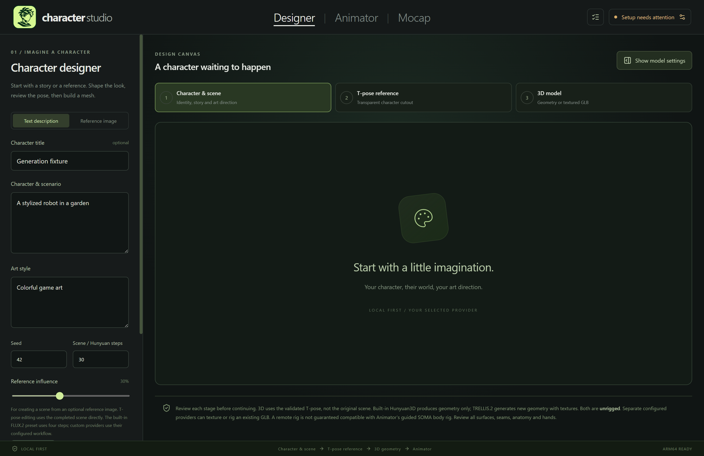

Actual desktop capture from an isolated UI fixture before generation, not an inference result.

1. For built-in presets, open **Backend connections** and connect the existing local ComfyUI. In Designer, refresh **Local model profiles**, choose installed weights, and **Save model choices**. Alternatively configure each relevant stage in [Model & workflow providers](#model-and-workflow-providers). Supported local missing-model warnings offer **Download required models** after approval. Designer does not require Kimodo's Llama encoder. The shared backend dialog reports Animator-specific readiness separately.
2. Choose **Text description** to describe the character, or **Reference image** (local PNG/JPEG/WebP, up to 20 MB and 32 megapixels) to supply a photo and describe what to use from it in **What to use from this photo**. Either way, Designer generates a new scene; a reference photo is conditioning, not a finished scene. Supply **Art style** separately. For example: a Brazilian MMA fighter raised in the jungles of Brazil, rendered as a vibrant 90s game character with exaggerated upper-body muscles.
3. Enter an optional title, or configure the naming provider. Built-in naming uses an already-installed Ollama instruction model at `http://127.0.0.1:11434`, runs on CPU, and unloads afterward; cloud-backed Ollama models are rejected on that local route. Remote/custom naming must be explicitly selected. Without a title or usable naming provider, generation stops rather than inventing a placeholder.
4. **Create character concept** generates a character-and-scene image using both descriptions. Image input is actual reference conditioning, not an ignored attachment. With built-in presets, select installed **IP-Adapter Plus** and matching **CLIP Vision** weights for visual identity; otherwise the native workflow uses basic img2img. **Reference influence** controls conditioning strength where supported by the selected provider. Native workflows center-crop non-square reference photos to the square scene size rather than stretching them, so faces and bodies keep their proportions; keep the subject near the middle of wide photos. The native scene's negative prompt discourages crowds, extra people, logos and watermarks because later stages expect one character.
5. Review the scene, then **Use scene & generate T-pose**. The native **FLUX.2 klein 4B image-editing workflow** encodes the actual completed scene as its reference, with the instruction **"Put this character in a T-pose, remove the background, only show the character."** Additional constraints request the same face, hair, outfit, colors, body proportions and art style, horizontal arms and visible hands/feet. The character/scenario and art-style descriptions are **not repeated**; this step edits the reference rather than recreating its brief. The distilled profile uses four steps, independently of the scene/3D step setting and scene reference-influence slider. Missing editing weights block the stage rather than silently falling back to SD/OpenPose regeneration. **Local BiRefNet background removal follows the edit**, preserving character colors and saving a validated transparent cutout. Review identity, pose, hands/feet and any attached scenery before continuing; image editing is not a guarantee of perfect preservation or anatomy. Older opaque T-poses have a **Remove T-pose background** action that masks the existing image without redrawing it.
6. **Use T-pose & generate 3D** revalidates the transparent cutout and scales it proportionally into a square with clear margins, without cropping or stretching. Hunyuan profiles composite only its foreground onto pure white for local image-to-geometry conditioning; the [textured profile](#local-textured-models) uses TRELLIS.2 instead. Original scenery and hidden RGB under transparent pixels are not used as background. Preview or save the GLB, then **Send to Animator** to import the generated mesh through Blender and fit/skin it using the existing character lab. This preserves the original generated GLB. Reopening the same design selects its existing Animator character instead of duplicating it.

The T-pose edit also explicitly requests **flat hands, palms down, straight fingers held together side by side, and thumbs resting naturally alongside**, with no splayed/curled fingers or fists. This is prompt guidance, not an anatomical validator; inspect hands before generating the mesh.

Scene and T-pose prompts also carry a built-in anatomy default that is not shown in the UI: humanoids have **five fingers on each hand** (four fingers and a thumb), with missing, fused or extra fingers discouraged in scenes. The default is skipped when the brief mentions fingers, digits, thumbs, claws, talons, paws, pincers or tentacles, so a described anatomy takes precedence. Like the hand-pose instruction, it guides generation and does not guarantee correct hands.

Regeneration stays on the selected step: **Character & scene** shows **Regenerate scene**, **T-pose reference** shows **Regenerate T-pose**, and **3D model** shows **Regenerate 3D** when the corresponding output is ready. Select an earlier step to regenerate it; later steps do not show earlier regeneration buttons. Before the next output exists, **Use scene & generate T-pose** and **Use T-pose & generate 3D** still let you advance from the preceding step. These actions use the current brief/sampling fields and saved model choices. A rerun creates and selects a saved variation, copying only the preceding references needed for that stage; it never replaces completed outputs or an existing Animator character. Changing an earlier stage does not carry forward stale T-poses or meshes. T-pose regeneration requires a scene; an imported isolated T-pose can generate 3D repeatedly without one. Scene prompts affect scenes, while T-pose editing keeps its fixed instruction and 3D uses the validated T-pose. Change the seed for a different sample; identical models, inputs and seeds may reproduce the same result. Controls remain locked during active work and until model-choice edits are saved. Animator's **Generate animation**, graph generation and batch reruns also remain repeatable, preserving completed takes and batch snapshots.

### Local textured models

Before generating 3D, choose **TRELLIS.2 (textured)** in **3D model profile**, select the four installed weights below, and **Save model choices**. Use **Use T-pose & generate 3D**, or **Regenerate 3D** on an already-completed design. This alternative generates both geometry and textures from the same validated T-pose in a new variation, preserving the original mesh. It does **not** paint an existing Hunyuan mesh.

The native ComfyUI graph generates structure, shape and texture latents in sequence, remeshes the decoded surface before simplification and UV unwrapping, then bakes a **base-color atlas plus metallic/roughness maps**. Remeshing avoids the fragmented UV islands and faceted appearance observed when simplifying the raw decoder output directly. Sampling uses fixed 12/20/12 structure/shape/texture steps, independently of the scene/Hunyuan step field. TRELLIS conditioning uses only the alpha-masked foreground on black, as required by its native workflow; Hunyuan's foreground remains on white. Neither sees the hidden original scenery. Textured runs prepare the T-pose at 1024 x 1024, matching TRELLIS conditioning, instead of first shrinking it to the 512px SD 1.5 scene size.

Three **Save model choices** settings control output quality. Defaults reproduce earlier output, and each completed design keeps the settings it used:

| Setting | Options | Effect |
|---|---|---|
| **3D shape detail** | **Standard: 512 single pass** (default), **High: 1024 refinement pass**, **Maximum: 1536 refinement pass** | High and Maximum add the native `Trellis2UpsampleStage` plus 12 more shape steps before decoding, and texture generation follows the refined shape. Maximum also remeshes at 768 instead of 512. |
| **3D texture size** | 1K (default), 2K, 4K atlas | Unwrap and bake resolution. Generation and Animator import require an atlas of exactly the selected size. |
| **3D target face count** | 25,000 to 200,000 (default 50,000) | Simplification target after remeshing. This is not game-ready retopology; more faces increase file size and slow Blender fitting and skinning. |

In one observed local comparison using the same T-pose and seed, High and Maximum produced visibly sharper eyes, nose, mouth and clothing folds than Standard. Maximum also shifted the hair color toward the skin tone, so results vary and still need review. On the RTX Spark development machine, a Maximum, 4K, 200,000-face run peaked at about 13.8 GB of reported GPU memory, within the existing 24 GB estimate. That was one sampled run, not a guaranteed requirement. Higher settings take longer and produce larger GLBs (about 12 MB for that run).

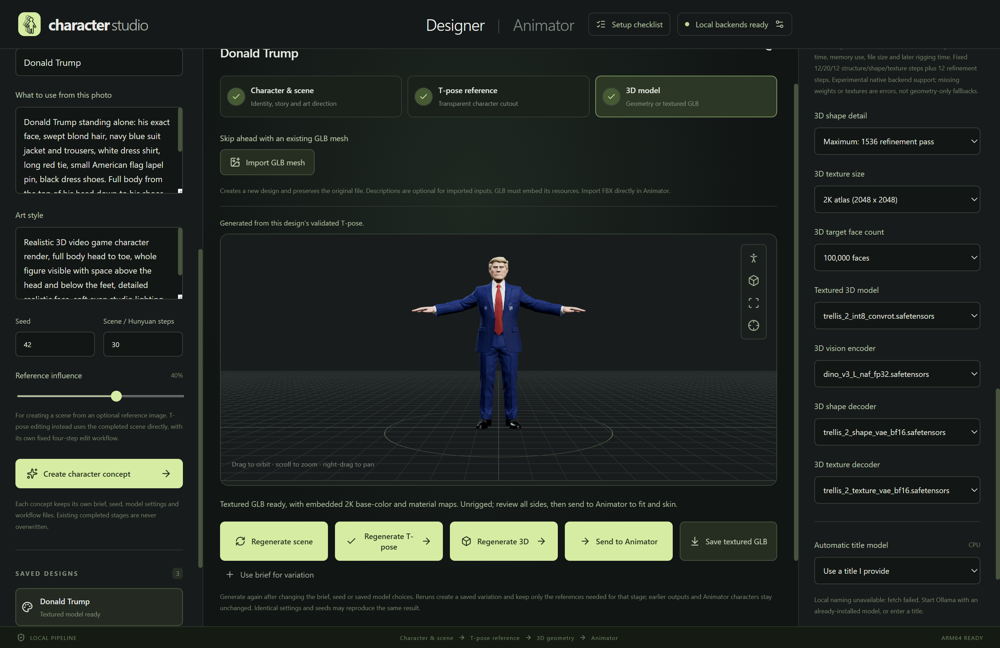

Actual desktop capture of a locally generated textured model using Maximum shape detail, a 2K atlas and 100,000 target faces. The scene and T-pose were generated from a user-supplied reference photo with the experimental settings shown; facial likeness, inferred back surfaces and clothing details still need review.
**Save textured GLB** exports one self-contained file with UVs and embedded textures. **Send to Animator** preserves the original GLB and checks that generated texture maps survive Blender import. Missing weights, unsupported native nodes, absent textures, incomplete UVs, corrupt PNGs or wrong-sized generated atlases fail explicitly; they are not published as completed textured models. Review all sides: back surfaces are inferred from one image, and clothing details, fingers, texture seams and lighting baked into color maps may need manual repair.

This profile uses the TRELLIS.2 branch of the [official native texture workflow](https://github.com/Comfy-Org/workflow_templates/blob/main/templates/3d_pixal3d_trellis2_image_to_model.json), without Pixal3D or cloud/API nodes. Install these approximately **8.5 GB** of weights manually or use **Download required models** when the stage reports missing weights:

| Selector | Required file | ComfyUI folder |
|---|---|---|
| Textured 3D model | [`trellis_2_int8_convrot.safetensors`](https://huggingface.co/Comfy-Org/TRELLIS.2/tree/main/diffusion_models) | `models\diffusion_models` |
| 3D vision encoder | [`dino_v3_L_naf_fp32.safetensors`](https://huggingface.co/Comfy-Org/Pixal3D/tree/main/clip_vision) | `models\clip_vision` |
| 3D shape decoder | [`trellis_2_shape_vae_bf16.safetensors`](https://huggingface.co/Comfy-Org/TRELLIS.2/tree/main/vae) | `models\vae` |
| 3D texture decoder | [`trellis_2_texture_vae_bf16.safetensors`](https://huggingface.co/Comfy-Org/TRELLIS.2/tree/main/vae) | `models\vae` |

Review the model cards and upstream/third-party licenses before distribution. A conservative **24 GB of currently free GPU memory** is required by this profile; this is not a measured minimum or a guarantee on every architecture. Use a ComfyUI version with the native TRELLIS.2, mesh unwrapping and texture-baking nodes. The app does not install backend packages, choose a remote service or silently change to geometry-only output.

### Start from external inputs

Select the **T-pose reference** or **3D model** step above the canvas, then use **Skip ahead with an existing T-pose/GLB mesh** to enter the pipeline later. The **Character & scene** step has no file import: scenes are always generated from a description, or from a **Reference image** plus a description of what to use from it.

| Existing input | Next action | Skipped work |
|---|---|---|
| T-pose with a white/colored background | **Remove T-pose background**, then **Use T-pose & generate 3D** | Scene and pose generation; cleanup masks the supplied image without redrawing it |
| Already-isolated transparent T-pose PNG | Check **Already isolated transparent PNG**, import, then generate 3D | Both image stages and background removal; the supplied cutout must pass validation |
| Embedded GLB mesh (up to 500 MB) | **Send to Animator** | All Designer generation stages; FBX files can instead be imported directly in Animator |

Descriptions and style are optional for imports. The visible brief is copied into the new design; a supplied title is retained, or the source filename becomes its title without invoking AI naming. Designs created by earlier versions from imported scenes remain usable. Direct T-pose-to-3D and GLB-to-Animator paths do not require scene/editing checkpoints or naming models.

Each import creates a **new design**, preserves a byte-for-byte original, and records its source filename and imported/generated provenance. Existing stages and downstream meshes are never replaced. Each generated stage consumes the preceding artifact from that same design and saves its input filename in the workflow manifest. Skipped stages remain empty, rather than being represented as generated results. Original images may be non-square; 3D input preparation preserves their aspect ratio.

### Offline models and memory profiles

Models must already be installed before going offline. Studio never downloads models or installs custom nodes/packages **during generation**. After a missing-model failure, **Download required models** starts a separate, explicitly approved setup operation; the [setup checklist](#first-launch-setup-checklist) can also download pinned Designer weights when you choose. Weight selectors come from the connected ComfyUI, not a fictitious installed-model list. Model licenses, GPU architecture, drivers, precision, and available system RAM still matter.

#### Download models from a warning

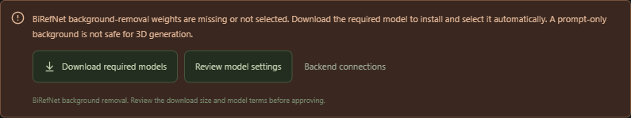

Actual desktop capture from a controlled missing-model setup fixture, not an inference result.

Use **Download required models** on a supported warning. The confirmation lists the files, maximum transfer size, upstream model pages and license information, and destination under the saved **ComfyUI backend folder**. Review those terms before choosing **Download & select**. Studio downloads only public, pinned safetensors from the listed upstream sources; it does not upload your character assets, collect credentials, or change Python packages.

The download panel shows byte progress and **Cancel download**. Files are checked against pinned sizes and SHA-256 hashes before publication. Existing verified files are reused; conflicting files are never overwritten. An interrupted or corrupt transfer is not treated as installed. Cancellation keeps previously verified files but leaves model selections unchanged. A later retry reuses those files; partial downloads are not resumed.

On completion, Studio refreshes ComfyUI, selects and saves the required models automatically, and leaves generation stopped. Click the stage's original action to retry. Downloads share the local job slot with Designer and Animator. If files are not visible to ComfyUI, Studio reports that setup is incomplete and does not change selections: check **Backend connections** against the actual running backend folder, check its native nodes, and restart ComfyUI if necessary before retrying.

Automatic packages cover BiRefNet, the FLUX.2 klein 4B edit components plus BiRefNet, DreamShaper 8 for SD 1.5, SDXL base 1.0, standard Hunyuan3D 2, and TRELLIS.2. Already-selected compatible weights are preserved. Hunyuan3D 2mini, other checkpoints, optional IP-Adapter, Ollama naming, native nodes and gated Animator models still require their documented setup. **Review model settings** and **Backend connections** remain available for those cases; Studio never silently switches profiles or accepts model access terms for you.

| Stage | Supported profile | Estimated available GPU budget | Setup |
|---|---|---|---|
| Scene | SD 1.5 / DreamShaper 8, 512px | 4 GB | Complete checkpoint in `ComfyUI\models\checkpoints` |
| Scene | SDXL, 1024px | 8 GB | Complete SDXL checkpoint |
| Scene-to-T-pose edit | Distilled FLUX.2 klein 4B, ~1 megapixel | 14 GB plus 2 GB cleanup | Native editing model, Qwen 3 4B encoder and FLUX.2 VAE (below) |
| Required T-pose cleanup | Native BiRefNet foreground segmentation | 2 GB alone; add 2 GB to edit-stage budget | `birefnet.safetensors` in `models\background_removal` |
| 3D geometry | Hunyuan3D 2mini, 128 decode resolution | 6 GB | Native single-view 2mini safetensors checkpoint |
| 3D geometry | Hunyuan3D 2, 256 decode resolution | 10 GB | Native single-view 2 safetensors checkpoint |
| Textured 3D | TRELLIS.2 INT8, 512-1536 shape / 1K-4K textures | 24 GB | Native TRELLIS.2, DINO vision, shape and texture decoder weights; see [textured models](#local-textured-models) |
| Optional title | Small local instruction model, e.g. Qwen 2.5 3B | CPU / system RAM | Already installed in local Ollama; not Kimodo's trained motion encoder |

These are conservative working budgets, not guaranteed minimum requirements or benchmarks. Optional scene IP-Adapter conditioning adds an estimated 2 GB; it requires separately installed compatible `ComfyUI_IPAdapter_plus` nodes, weights in `models\ipadapter`, and vision weights in `models\clip_vision`. It is not used by the T-pose editor. Each stage checks **currently free memory on one GPU**, not summed VRAM or nominal capacity. No CPU-only image/3D fallback is claimed. Lower-memory machines can generate scenes and import external cutouts when editing is unavailable. Scene, editing and 3D weights are selected independently. SD 1.5 and SDXL adapters are not interchangeable.

For T-pose editing, use the [official ComfyUI single-image FLUX.2 klein 4B distilled workflow components](https://github.com/Comfy-Org/workflow_templates/blob/main/templates/image_flux2_klein_image_edit_4b_distilled.json), approximately 12.5 GB total:

| Selector | Weight file | ComfyUI folder |
|---|---|---|
| T-pose edit model | [`flux-2-klein-4b-fp8.safetensors`](https://huggingface.co/black-forest-labs/FLUX.2-klein-4b-fp8) | `models\diffusion_models` |
| Edit text encoder | [`qwen_3_4b.safetensors`](https://huggingface.co/Comfy-Org/z_image_turbo/tree/main/split_files/text_encoders) | `models\text_encoders` |
| Edit autoencoder | [`flux2-vae.safetensors`](https://huggingface.co/Comfy-Org/flux2-dev/tree/main/split_files/vae) | `models\vae` |

The 4B model and Qwen encoder use Apache 2.0. The shared FLUX.2 autoencoder is also [explicitly Apache-licensed upstream](https://github.com/black-forest-labs/flux2#flux2-autoencoder), separately from FLUX.2-dev diffusion weights. This integration does **not** use FLUX.2-dev, 9B or base-model sampling profiles. An unquantized `flux-2-klein-4b.safetensors` is also accepted, but may need more memory than the FP8 option. Select the installed files and save model choices; OpenPose weights are no longer required for Designer.

Use the [official native Hunyuan3D setup](https://docs.comfy.org/tutorials/3d/hunyuan3D-2). This integration supports single-view Hunyuan3D 2 and 2mini, **not** turbo, multiview or 2.1 sampling profiles. Keep descriptive checkpoint names containing `hunyuan3d` (and `mini` for 2mini), so incompatible profiles are not accidentally selected. Do not select cloud/API Tripo or Hunyuan image nodes.

The standard native checkpoint is [`hunyuan3d-dit-v2_fp16.safetensors`](https://huggingface.co/Comfy-Org/hunyuan3D_2.0_repackaged/tree/main/split_files), approximately 4.9 GB, placed in `ComfyUI\models\checkpoints`. Review its [Tencent Hunyuan Community License](https://huggingface.co/Comfy-Org/hunyuan3D_2.0_repackaged/blob/main/LICENSE) before use. Select **Hunyuan3D 2 (geometry)** and this checkpoint, then save model choices.

Background removal uses [Comfy-Org's native BiRefNet weights](https://huggingface.co/Comfy-Org/BiRefNet), also listed in the official `utility_birefnet_remove_background` workflow. Its missing-model warning can download the approximately 424 MiB safetensors into `models\background_removal`, verify it, refresh ComfyUI and select it automatically. Manual installation remains supported. Subsequent cutout processing is local/offline. A missing segmentation model blocks T-pose completion, not scene generation.

Observed Designer runs have exercised DreamShaper 8 scene generation, FLUX.2 klein scene-image editing, BiRefNet isolation, and standard native Hunyuan3D 2 geometry with Blender/Animator handoff. A separate native TRELLIS.2 run started from that edited cutout and produced a textured GLB with embedded 1K material maps, which survived export and Blender/Animator import. The earlier SD/OpenPose T-pose path was replaced because it changed clothing and identity. With [automatically fitted landmarks](#automatic-landmark-fitting), the bundled Blender rigging backend weighted every vertex of two saved TRELLIS.2 Designer meshes (about 33,000 vertices each) without repair or fallback. These runs do not establish good deformation, animation of generated meshes, rigging of Hunyuan3D geometry, compatibility on other machines, or production quality. Automatic naming still requires a separately installed local Ollama model and has not been exercised with real naming weights.

**Scope:** native Hunyuan3D produces **untextured, unrigged geometry**; it does not bake the reference's colors onto the mesh. TRELLIS.2 adds local texture synthesis, but its output is also unrigged. Neither profile guarantees retopology, fingers/faces, precise pose, faithful unseen surfaces or production-ready game assets. Review and potentially repair the mesh before guided humanoid rigging.

Designs, reference copies, settings snapshots, and API workflow JSON live under `%APPDATA%\KimodoStudio\designs` with an independent `designer.json` index. Generated stages publish only a validated output from their own completed ComfyUI history entry; imports are labeled separately, and opaque T-poses remain blocked from 3D until cleanup. Cancellation targets only that prompt; restart marks interrupted stages failed while keeping earlier completed references. Failed stages can be retried after fixing setup. Completed stages can be regenerated as new saved variations, never overwritten. Current saved model choices apply to the stage being generated; copied references retain their original workflow manifests and image model family.

## Animator workflow

1. **Import FBX.** A copy of the original is preserved. Geometry/materials are converted locally with Blender; embedded textures are kept. Working copies are normalized to two meters in height. The camera starts facing the character. T-pose orientation is estimated from shoulders and feet; review the facing direction when FBX axes differ.
2. **Fit & skin.** Full-body, upright T-poses are the expected input; a clear A-pose can also be fitted. Landmarks start [automatically fitted to the mesh](#automatic-landmark-fitting); **Auto-fit landmarks to mesh** refits them for the current orientation. Adjust orientation and joint positions in both front and side views. Click a landmark and drag its axis handles, or edit XYZ coordinates. Symmetric fitting is enabled by default. Save the fit, then **Build skin + rig**.
3. **Connect local ComfyUI.** Open Backend connections. Default backend folder is `%LOCALAPPDATA%\ComfyUI`, API `http://127.0.0.1:8189`. The app can start this backend using its existing venv; it does not replace PyTorch or Transformers. For a ComfyUI already running elsewhere, select its actual port and output directory.
4. **Describe motion** and generate. Periods separate motion segments; duration applies to each segment. Jobs display progress and persist across restarts. Cancel targets only the app's prompt, never the global ComfyUI queue.
5. **Preview and export.** Completed clips support play/pause, scrubbing, orbit, zoom, and wireframe. Download animated GLB, animated FBX, or editable Blender scene. BVH/NPZ are separately labeled **motion-only** data. Partial/failed jobs never expose completed-character downloads.

### Automatic landmark fitting

Generated meshes rarely match the standard landmark template. Joints left outside the body give Blender's bone-heat solver nothing to attach, so skinning fails or attaches the wrong parts. When a character is imported, Studio estimates the landmarks from the mesh using the suggested orientation. This applies to both FBX imports and Designer meshes sent to Animator.

The estimate is built from cross-sections of the actual surface:

- It locates the torso, arms, wrists, legs, knees and feet.
- It centres each joint inside the body.
- It checks that every joint is enclosed by the mesh.

Import warnings name any joint that needs attention. If fitting is impossible, the import still completes with the template landmarks and a warning.

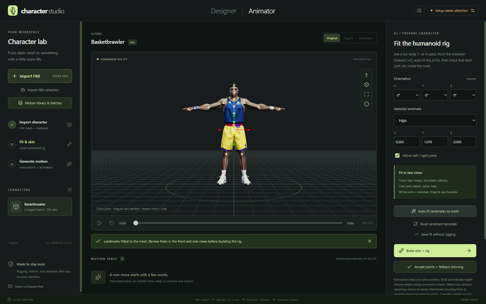

Auto-fit on a saved TRELLIS.2 Designer mesh, captured in an isolated workspace. That workspace's backend is not configured, which is why the header shows **Setup needs attention**. Before auto-fit, the template put this character's feet and leg joints below the mesh and its hands beyond the fingertips. The capture shows joint placement only: it is not a completed rig and does not show deformation quality.

**Auto-fit landmarks to mesh** in **Fit & skin** refits the selected character for the orientation shown in the panel. Use it after correcting the facing, or to replace template landmarks saved before this feature. It changes only the unsaved landmark edits. Review the joints in the front and side views, then choose **Save fit without rigging** or **Build skin + rig**, which saves them first. If auto-fit can't place the joints, your current landmarks are kept and the error explains what was missing.

Auto-fit is a geometric heuristic. It expects a single standing humanoid in a T- or A-pose, with arms clear of the torso and legs separated. It doesn't handle:

- Fingers or faces.
- Seated or crouching poses.
- Quadrupeds or props.
- Wide skirts or robes that join the legs.

Shoulders, elbows and knees are estimated from proportions and cross-sections, so check bending before animating. With auto-fitted landmarks, the bundled Blender backend produced complete 22-bone skins for two saved TRELLIS.2 Designer meshes and the Bruiser sample: every vertex was weighted and no repair was needed.

A 759,039-vertex textured character from another image-to-3D generator was also tested. It was imported with a −90° suggested rotation. After auto-fit, **Build skin + rig** weighted every vertex automatically in about two minutes. In one posed test render it bent cleanly at the hips, knees, elbows and neck. Complete weights and a single test pose don't establish animation quality.

### Hand pose and rig detail

**Choose detail during Fit & skin.** **Left hand rig detail** and **Right hand rig detail** independently support **Wrist only - fixed finger shape** (the compatible default) and **Basic three-chain**. Basic adds two thumb bones, three index bones and three bones shared by the remaining fingers; it does not remove fingers from the mesh. Individual fingers remains a disabled future option. From a built rig, **Hand pose & rig detail > Change hand rig detail & fitting** returns to these controls.

**Fit the hand before rebuilding.** Selecting Basic adds an editable template, not automatic hand detection. Place point 1 at each knuckle, subsequent points at bends and the final point at the tip. `PalmNormal` points out of the **back** of the hand and establishes its bend plane. Use **Focus left hand / Focus right hand**, front/side views, the landmark selector, and 1mm XYZ fields. Influence radii are meters in the normalized 2m character frame, bounded to 3mm-8cm; the grouped region is normally wider. Body auto-fit keeps manual hand points; use **Reset left/right hand template** explicitly when needed. **Try auto-rigging** or **Use adjusted points + fallback skinning** builds the result. Finger regions redistribute only nearby wrist/forearm weights, leaving other body influences untouched. Missing hand influence fails rather than publishing an empty finger rig.

Edit **Left wrist X/Y/Z** and **Right wrist X/Y/Z** to preview rotations on the actual skinned rig. Angles range from -180 to 180 degrees in XYZ order, using the normalized character's rest-frame axes (+Y up, +Z forward). The offsets follow the animated wrist; these are not automatically calibrated anatomical bend/twist axes or a world-space hand lock. **Copy left rotation to right** copies the same signed angles, not a mirrored grip.

Built Basic hands expose **Open**, **Relaxed**, **Fist**, **Close whole hand**, independent thumb/index/grouped curl, and thumb opposition. Controls are 0-1; zero keeps the fitted mesh's existing shape. **Save hand pose** persists without running Blender or rebuilding skin weights. **Reset wrist rotations** resets only wrists; **Discard hand pose changes** restores the saved pose and keys. Save or discard before leaving or generating motion. Changing fitting/detail requires rebuilding; choosing Wrist only clears that side's finger controls and keys, not its geometry.

**Animate opening and closing.** Enable **Animate fingers over clip**, scrub **Hand key preview**, and edit controls at that time to insert/update a key. Up to 16 ordered keys span 0%-100% of each clip, with linear interpolation. **Open-close-open hand animation** supplies a three-key starting point; **Remove selected hand key** removes interior keys. Motion graph nodes can **Override character finger pose for this node** using the same editor. The rigged preview scrubs these local controls; new character GLB, FBX and Blender animations bake them after body retargeting. This is authored finger animation, not learned motion from the text model.

**Preserve path continuity.** Branches keep the parent's full saved hand timeline unchanged. Wrist offsets and hand fitting/detail must match the parent. Without a transition the child starts at the parent's actual final finger pose; graph transitions interpolate between the two endpoints. Looping nodes require matching first/last hand keys. Jobs/manifests retain the pose, fitting signature and full-path spans. Batches freeze character poses plus node overrides, and reject reruns if hand fitting/detail changed. Older batches retain wrist-only behavior and zero offsets. Completed takes never receive current hand settings again; motion-only BVH/NPZ remain the original source motion.

**Bake a fixed FPS grip.** Pose a Basic hand, or disable finger animation at the desired preview time, then save. **Bake fixed grip as new wrist-only character** creates a separate working variation: finger deformation becomes geometry, finger weights collapse onto each wrist, and only the 22 body bones remain. Source geometry, UVs/materials, original character and completed takes are preserved. Wrist offsets stay separate and editable rather than being applied twice. **Export fixed-grip GLB / FBX / Blender** exports the skinned rig at rest wrists; saved wrist offsets apply to new animations, not these static rig files.

**Limitations:** Wrist-only cannot manufacture a grip from flat geometry. Three-chain fitting is guided, approximate rigging, not universal hand repair; fused/missing digits, sparse topology, adjacent-finger leakage and self-intersection may require manual mesh/weight cleanup. Grouped middle/ring/little fingers do not bend independently. There is no collision/contact solver, automatic weapon fitting, anatomical wrist calibration, individual-finger retargeting or learned hand fitting. No extra inference model or GPU is required; rig building, grip baking and character export require the existing local Blender runtime. Representative generated-hand quality has not been evaluated for this feature.

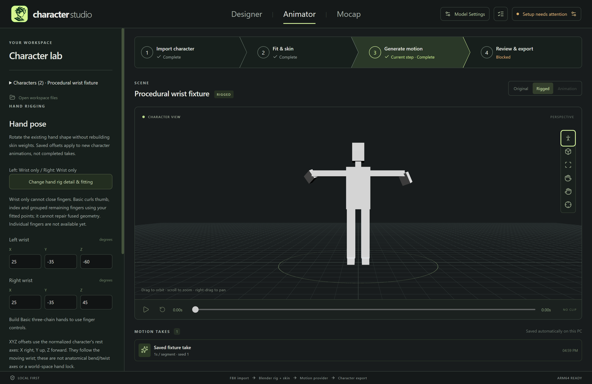

Wrist-only controls on an actual desktop/MCP procedural fixture.

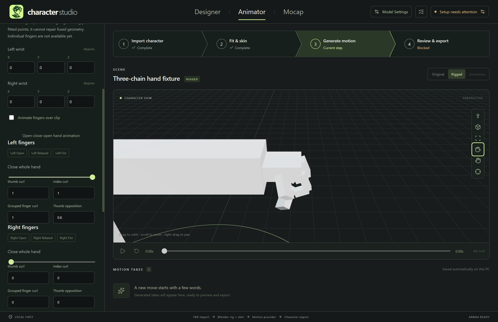

Actual desktop/MCP capture of authored finger controls, not a generated hand or a production-quality grip.

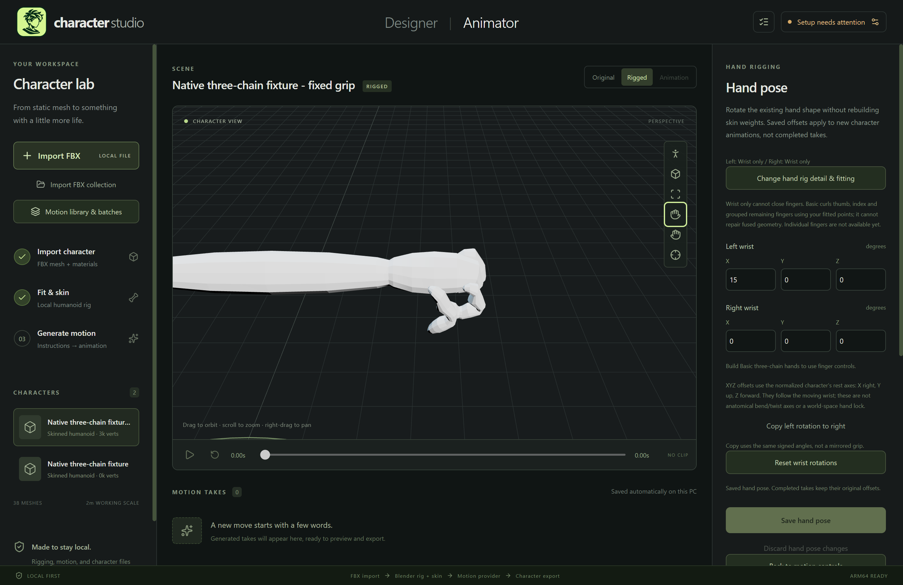

Actual desktop/MCP capture of a native Blender bake on a procedural capsule fixture. It demonstrates the separate variation, not weapon contact quality.

After `npm run build`, `node --import tsx scripts\hand-pose-smoke.mjs` exercises fitting, visible wrist/finger deformation, key scrubbing, graph overrides, save/discard/reset, restart persistence and immutable takes without Blender or weights; it is included in `npm run test:mcp`. `npm run test:rigging` verifies native skinning, keyed GLB vertex parity, FBX round-trips, parent-timeline preservation, seam rejection and fixed-grip geometry. After `npm run setup:blender`, `npm run test:hand-desktop` exercises a real native bake, source preservation, 22-bone export through the visible file picker and restart persistence. These checks use procedural fixtures, not a third-party character or learned inference.

### Recovering from incomplete skinning

**Build skin + rig** uses your fitted points, runs Blender bone-heat weighting, and automatically attempts to fill unweighted vertices from the closest weighted vertex along connected mesh edges. Existing positive weights are retained before the usual four-influence limit and normalization. Repair does not move your points, remesh the character, alter materials, or overwrite the original import.

Generated textured meshes, such as TRELLIS.2 output, are often split into many UV islands with duplicate vertices along every seam. Blender's bone-heat solver can fail on small islands hidden from their nearest bone, leaving the entire mesh unweighted. **Build skin + rig** therefore solves bone heat on a temporary copy with coincident seam vertices merged, then maps the weights back to the original vertices. Seam duplicates receive identical weights, so the seams don't crack when posed. The exported mesh keeps its original vertices, UVs and materials; `rig-report.json` records the merged count as `seamWeld`.

Bone heat can also leave a whole detached piece unweighted, or fail for the entire object, when other geometry hides that piece from every bone. A part enclosed by an inward-facing or double-sided surface is one example. After the combined solve, **Build skin + rig** therefore solves each completely unweighted piece on its own, up to 64 per mesh, largest first. Other pieces can't hide it there. Weights are kept only for vertices that receive them. A warning reports the pieces solved this way, and `rig-report.json` records them as `heatRetry`. Check that those pieces bend with the expected bones.

If a disconnected piece still has no weights, surface-based repair cannot attach it. Adjust the points in **Fit & skin**, or choose **Accept points + fallback skinning** to keep your current fit and try approximate weights based on distance to the two nearest fitted bone segments for the remaining vertices. This action saves unsaved point edits first, also tries normal bone-heat weighting and connected-surface repair, and is available without a prior failed attempt. Batches use automatic surface repair only; they never silently opt into proximity fallback.

Both actions require every vertex to have usable weights, required body bones to influence the mesh, and the exported skinned GLB to pass validation. Failed/cancelled jobs do not publish a new completed rig. A failed retry keeps the fitted points and earlier completed jobs; editing points invalidates the character's current rig until rebuilding succeeds.

**Rig notes** show repair counts and approximation warnings and persist across restarts. Recovery warnings also follow generated motion reports. Complete weights are not proof of good bending: inspect the result and review animation before production use, particularly shoulders, hips, touching limbs, clothing, and separate pieces. This is weight repair, not automatic topology cleanup; severe intersections or malformed geometry may still need Blender cleanup. Imported external armatures/weights are still replaced in the working copy.

Run `npm run test:rigging` after `npm run setup:blender` for regressions using procedural test geometry. It covers native recovery, seam welding, separate-piece bone-heat retries, coverage, fitted-bone preservation and GLB round-trips. `npm test` covers landmark auto-fit on procedural box humanoids and rejection of non-humanoid shapes. `python -m unittest discover -s tests -p test_skin_weights.py` runs the pure repair tests without Blender. After `npm run build`, `node --import tsx scripts\rigging-smoke.mjs` exercises the desktop recovery controls with explicitly simulated backend responses and captures the panel. These fixtures do not establish repair quality on real generated characters.

## Local Llama, not remote inference

Kimodo uses a trained **Llama 3 8B + LLM2Vec** text encoder with its MNTP and supervised adapters. Inference happens on this computer. Hugging Face supplies the initial model downloads; it is not an inference endpoint.

Studio starts ComfyUI with `TEXT_ENCODER_MODE=local` and `TEXT_ENCODER=llm2vec`. If you start ComfyUI separately, set those variables in its process as well. The app does not change an already running backend's configuration.

### First-time model access

Open the top-right **Backend connections** button (it may display **Setup needs attention**), then **Model access & local setup**. The guide is always available, and expands automatically when the Llama check is blocked.

1. Sign in at <https://huggingface.co/meta-llama/Meta-Llama-3-8B-Instruct>. On **Model card**, find the license panel headed **You need to agree to share your Hugging Face information to access this model**. Click the wide **Expand to review and access** button beneath the license text. Review the terms/data-sharing notice, fill out the form, and submit only if you agree. Neither **Use this model** nor a paid inference provider is needed. Use this exact model, not the suggested Llama 3.1 upgrade.
2. Wait until the model page shows access is granted. Browser login and a pending request are not approval. The model owner handles approval.
3. Sign in locally with the same account using the existing ComfyUI environment. The in-app guide displays the exact PowerShell command for your **saved** backend folder; with the default path:

   ```powershell
   & "$env:LOCALAPPDATA\ComfyUI\venv\Scripts\hf.exe" auth login
   & "$env:LOCALAPPDATA\ComfyUI\venv\Scripts\hf.exe" auth whoami
   ```

   Choose browser sign-in if offered. If prompted for a token, create a **read** token at <https://huggingface.co/settings/tokens>; fine-grained tokens must permit reading the approved gated model. Enter it only in the CLI's secure prompt, not in command arguments, Studio, or chat. Studio does not collect credentials. Already signed in correctly? Skip login. To switch accounts, append `--force` to `auth login`. Do not reinstall/downgrade ComfyUI packages just to sign in.
4. Refresh the app's readiness checks, start local ComfyUI if needed, and generate. The first run downloads many GB of encoder weights/adapters; allow enough disk space and download time. Inference remains local.

**If approved but blocked:** verify the exact model, CLI account, and gated-model token permissions. `HF_TOKEN` in the launching environment overrides a saved login; check its configuration without exposing its value. Restart an already-running ComfyUI after changing authentication. Readiness distinguishes absent credentials, rejected login, denied download permissions, and network/service failures.

**Original encoder limitation:** the Llama full-pipeline attempt was blocked by the model-download access check. The experimental LFM path has since produced a real learned walk with skinned character exports; this does not demonstrate Llama authorization or equivalent motion quality.

### Alternatives

An already-authorized installation in the Hugging Face cache used by ComfyUI can reuse its weights without a new access request. It also needs the tokenizer, configuration, and both LLM2Vec adapters. The app does not currently offer an arbitrary local-model-folder selector, and cached base weights alone are not a guarantee of a complete offline installation.

vLLM is **not a drop-in replacement**: a generic chat/embedding model does not reproduce the checkpoint's trained LLM2Vec conditioning, and an inference server does not eliminate the need for authorized weights. [Official vLLM requires Linux rather than native Windows](https://docs.vllm.ai/en/stable/getting_started/installation/gpu/). Studio instead reuses the working native ARM64 PyTorch/CUDA environment.

Studio now includes an **experimental ungated LFM bridge** that keeps Kimodo and replaces only text conditioning. The original Llama/LLM2Vec option remains the default for existing workspaces. Generic embeddings are still not a model-name substitution: the bridge specifically maps LFM document embeddings into Kimodo's trained LLM2Vec space. See [Kimodo's official installation requirements](https://research.nvidia.com/labs/sil/projects/kimodo/docs/getting_started/installation.html) and the [LLM2Vec adapter's base-model declaration](https://huggingface.co/McGill-NLP/LLM2Vec-Meta-Llama-3-8B-Instruct-mntp/blob/main/adapter_config.json).

### Experimental LFM setup (no Llama approval)

From the source repository, using the existing ComfyUI environment:

```powershell
.\scripts\setup-lfm.ps1
# For a different backend:
.\scripts\setup-lfm.ps1 -ComfyRoot 'C:\path\to\ComfyUI'
```

The script downloads approximately 0.8 GB of public assets: [LiquidAI/LFM2.5-Embedding-350M](https://huggingface.co/LiquidAI/LFM2.5-Embedding-350M) and the community [LFM-to-Kimodo v2 bridge](https://huggingface.co/adriandj3/LFM2.5-to-Llama8B-LLM2Vec-Kimodo). No Hugging Face login or Meta approval is required. Revisions are pinned, weights/checksums are verified, and upstream model/bridge licenses are downloaded with the assets. It installs only Studio's `studio_kimodo_lfm` custom node; it does not replace ComfyUI packages or edit upstream Kimodo. Assets stay in the local Hugging Face cache, outside Git.

Restart ComfyUI, choose **LFM bridge (experimental, no access approval)** under **Backend connections > Kimodo text encoder**, save settings, and refresh readiness. Portable users need this one-time setup from the source checkout as well. The selected encoder applies to node clips, state loops, branches, and transitions. Jobs, batch snapshots and export manifests record the encoder; rerunning a saved batch requires selecting its original encoder (legacy batches retain Llama). Switching back to the original option restores the existing Llama workflow; there is no silent fallback from LFM to Llama or hosted inference.

The selector displays the detected GPU name and currently free/total memory. It recommends the smaller LFM bridge below **24 GiB free**, and the original Llama encoder with more headroom at or above that budget. This is conservative guidance, **not a measured minimum or a guarantee**. Download sizes (~0.7 GB versus ~16 GB) are not peak memory requirements: LFM uses float32, and Kimodo, duration, other models and shared/unified memory affect actual usage. With less than 4 GiB free, the UI warns that even LFM may be tight. Missing GPU information leaves the choice manual. Refresh readiness to update the reading; recommendations never silently change the saved encoder.

**Quality and compatibility:** the bridge approximates LLM2Vec embeddings; it does not retrain Kimodo or establish equal motion quality. Its author reports that fine details such as handedness can drift and that v2 lacks new motion-quality testing. Review prompts, stance, feet and joins before production use. Existing pose constraints, seam checks and skinned export validation remain enabled. The adapter uses float32 document/CLS embeddings, bidirectional attention, historical unmasked convolution padding, and no source-vector normalization. Bidirectional changes are instance-local rather than the upstream encoder's global Transformers patches. The installed Windows ARM64 Transformers environment differs from the author's calibrated versions; no packages are downgraded to match them.

**Licensing:** the bridge is Apache-2.0, but LFM is under the **LFM Open License v1.0**, including its $10M annual-revenue commercial-use limitation. It is not unrestricted MIT/Apache licensing. Kimodo's own terms remain applicable.

**Observed branch limitation:** a learned walk-to-punch branch failed the existing endpoint checks at both 25 and 100 denoising steps (about 2.46m root mismatch and 27-30 degrees maximum body rotation error). The app correctly refused a completed continuous-path export. This experiment does not establish whether the cause is encoder approximation or existing Kimodo constraint behavior; constrained graphs/loops are not validated for production with LFM.

The real-inference harness below requires the user-supplied `artifacts\Bruiser_base.fbx`, native Blender, and a running ComfyUI with the LFM node. It creates a fresh artifact workspace, generates independent walk/punch clips, and validates skinned exports. Optional branch validation retains the strict endpoint checks and exits with an error when they fail. It does not claim visually equivalent motion quality:

```powershell
node --import tsx scripts\lfm-integration.ts
# Optional alternate local API port:
node --import tsx scripts\lfm-integration.ts http://127.0.0.1:8190
# Optional constrained branch experiment (currently observed to fail endpoint checks):
node --import tsx scripts\lfm-integration.ts http://127.0.0.1:8190 --branch
# Built Electron UI with real GPU detection, saved LFM selection, generation and skinned exports:
npm run build
node --import tsx scripts\lfm-desktop-smoke.mjs http://127.0.0.1:8190
```

## Visual animation graphs

Open **Motion library & batches**, then choose **Fighting graph template**. It contains a fighting idle state, a low crouch state, and **one shared Right hook action** with both `idle -> punch` and `idle -> crouch -> punch` connections. Select Punch and use **Incoming context** to inspect the two paths and their inherited stances.

Drag nodes to arrange the graph; drag an output dot to an input dot to connect nodes. Select a node to edit its instructions, duration, seed and state/action type. Select a connection to edit its transition duration. Mark the entry nodes with **Start graph here**. Positions and connections are saved with the configuration.

- **State nodes** describe a sustained posture, such as a fighting idle or crouch. They are generated in that posture and aligned to the preceding character's horizontal position and heading, without flattening the destination's root height.
- **Action nodes** are reusable instructions, such as "Throw a right hook punch." Each incoming path receives its own generated variant, conditioned on the actual previous endpoint and guided by the inherited stance. A standing punch is not reused as a crouched punch. Explicit instructions can change stance; the optional **Outgoing stance** clarifies the resulting posture for later nodes. The actual incoming pose takes precedence over textual posture guidance. There is no separate reasoning model inferring semantic postconditions; review model compliance and set an outgoing override when a change should propagate.
- **Connections** create separately generated transitions constrained at both endpoints. Zero seconds requires a direct pose match instead. Node clips, incoming transitions and complete paths have independent GLB/FBX/Blender exports and previews. Each part uses the same path-relative root origin.
- **State loops** use a second generation pass constrained to return to the initial pose. Endpoint root and body rotations are checked, but this does not guarantee velocity continuity, foot-contact quality or a visually seamless loop. Turning off the checkbox produces an ordinary non-looping state clip.
- **Pose continuity** is checked at every join: maximum 2cm root error and 5 degrees body-joint rotation error. Incorrect frame counts, mismatched endpoints or failed exports block the result instead of silently publishing disconnected motion. Duplicate boundary frames are removed from assembled paths. A transition into an action already starting at the previous endpoint may be a short hold.
- **Cycles** are finite: each path includes its first revisited node once, then stops. This exports a cycle traversal, not an endlessly growing queue or an in-engine state machine. Limits are 32 nodes, 64 connections, 64 path-specific variants per character and 60 seconds per path including transitions. Unreachable nodes must be connected or marked as starts.

Graph instructions are treated as one clip per node; punctuation does not create extra segments. Older configurations migrate without changing their prompts, seeds or period-separated segment durations, using direct-pose connections. Selecting a node type explicitly opts a legacy node into the new single-clip behavior.

**Endpoint failures:** **Generated motion did not honor its endpoint pose** means the sampled clip failed the 2cm/5-degree join check, not that the preceding PyTorch deprecation warning stopped generation. Conditioning does not guarantee an exact pose match: the built-in graph exports the Kimodo sampler's motion without running its optional motion-correction stage. A different node seed or more denoising steps in a **new batch** may help, but does not guarantee success. **Run same batch again** preserves the original snapshot, including seeds and steps. Failed joins remain failed; installing an optional correction package alone does not enable a correction stage in Studio.

## Repeatability and collections

Open **Motion library & batches**, or **Save this configuration** beside the current prompt.

- **Configurations** save exact instructions, duration, seed, denoising steps, in-place mode, a humanoid landmark fit, and a named motion graph. Save as copy for a variation, or import/export versioned JSON. Apply a prompt/settings preset to another FBX; optionally reuse its rig landmarks while preserving the new FBX's detected orientation.
- **Branches** can also start directly from a completed take in Character lab. Studio exports the actual parent's endpoint as a Kimodo `FullBodyConstraintSet` at child frame zero, including root location/height and joint rotations, and validates the join.
- **Collections** accept multiple FBX imports. Select up to 32 characters. Jobs run sequentially to avoid competing GPU allocations. Existing rigs are preserved. The optional saved-fit setting rigs unrigged characters; this assumes similar humanoid proportions and still requires visual review.
- **Identical motion** generates once per **path context**, including its transitions, and reuses the exact source motion across target characters, retargeting it to each rig. It never substitutes a different incoming path. **Variation** instead applies a deterministic seed offset (1, 100, or 1000) per character. The seed is `node seed + character index * offset`, modulo 2^32; transitions use the next seed. Seed variation changes the sampled performance, not a calibrated motion-intensity value.
- **Batch snapshots** preserve their configuration, target order, and effective seeds even if you edit the original preset. *Run same batch again* uses that immutable snapshot. New generations with the same seed are intended to be repeatable, but bitwise reproducibility across different model/software/hardware versions is not promised.
- **Save outputs** writes completed character files into a new batch folder, one character/motion directory each, with configuration and per-job manifests. Failed/blocked items are identified in the batch manifest and do not gain fake output files. Cancellation retains completed results; restart marks interrupted work blocked until explicitly rerun.

The branch constraint serialization, conversion to the real SOMA30 model skeleton, seam validation, and branch assembly are exercised without downloads. The graph integration harness uses clearly labeled analytic standing/crouching poses, loops and transitions on real Bruiser meshes. This verifies context isolation and real skinned exports, **not learned motion quality**. The separate LFM harness uses actual learned inference; constrained LFM branch attempts failed the strict endpoint checks.

## Backend and limitations

- Official **Blender 4.5.15 LTS ARM64** portable distribution, checksum-verified by `scripts\setup-blender.ps1`. Isolated under `.tools`; no CUDA auto-rigging packages are installed into ComfyUI.
- A real 22-bone humanoid body rig, Blender bone-heat skinning, maximum four normalized influences per vertex, and required body-bone/vertex-coverage checks. This is **guided rig fitting**, not an unvalidated universal AI auto-rigger. Fingers/faces, cloth, quadrupeds, and arbitrary poses are outside this version.
- SOMA-77 global body rotations are converted from Y-up into Blender coordinates, corrected for the fitted target rest pose, and baked onto the skinned character. Root trajectory is scaled to the character; optional in-place mode removes horizontal root displacement. Fine source finger motion is not retargeted; optional Basic hand poses/tracks are authored locally and applied after body retargeting.
- FBX export uses Blender, **not** the unavailable ARM64 Autodesk Python SDK.
- Foot contact cleanup is not installed. Foot sliding, extreme joint bends, or imperfect automatic weights can require manual cleanup. Playback looping is not a promise of a seamless looping animation.
- Imports start from geometrically estimated landmarks for standing T- or A-pose humanoids. This is not learned pose detection; unusual proportions, poses, clothing or props can require manual placement.
- Fully unweighted detached pieces are re-solved separately with bone heat. Missing weights that remain trigger connected-surface repair. Proximity fallback requires **Accept points + fallback skinning**, retains fitted joints, and records approximation warnings. Complete vertex coverage and required-bone checks still apply; repair does not guarantee correct deformation or fix intersecting/non-manifold geometry.
- Built-in ComfyUI and desktop MCP remain loopback-only. Configured Remote providers can receive prompts/assets only after per-stage approval. Downloaded weights and workspace data remain local; remote services have their own retention policies. ComfyUI/custom nodes and API gateways are trusted software, not sandboxes.

## Data and reproducibility

Workspace data continues to live in `%APPDATA%\KimodoStudio` for backward compatibility: `studio.json`, original FBX copies, packed working scenes, rigs, job logs, and completed outputs. Renaming the app does not move or reset existing work. Use **Open workspace files** in the app. Rig edits invalidate the old rig until rebuilt; old completed animation jobs remain immutable. On restart, interrupted jobs are marked failed rather than complete. `comfy-server.log` contains logs from the app-owned backend. ComfyUI writes to that file directly rather than through the app, so a backend that outlives an app session keeps a working console. If a generation fails with **[Errno 22] Invalid argument** from a ComfyUI started before this change, the app reports that ComfyUI lost its console output: stop that `python main.py` process, then use **Start local ComfyUI** and retry.

`ai-providers.json` saves non-sensitive route selections and append-only configuration history. Routed outputs retain provider/model, configuration/workflow hashes, task IDs, and the actual bound ComfyUI graph in stage-specific `*-provider.json` files. Designer exposes **Saved provider provenance**; MCP snapshots and motion manifests also contain provenance. Reused outputs retain source metadata, and batch snapshots preserve the original motion route. Existing all-local outputs retain their original workflow/config manifests. `ai-credentials.json` contains only endpoint-hashed, OS-encrypted values; it is excluded from Git, snapshots and exports, and is not a portable credential backup. Treat workspace prompts, assets and endpoint metadata as private even though they contain no intentionally stored API keys.

The actual supplied `Bruiser_base.fbx` has 198,581 vertices and no existing rig. The body backend is tested against this file, including native skinning, real vertex deformation, and GLB/FBX reimport. The fitted sample setup is in `tests\fixtures\bruiser-setup.json`. Landmarks auto-fitted from its mesh also produced a fully weighted 22-bone rig.

**Analytic motion fixtures are tests, not generated clips.** `artifacts\bruiser-analytic-test` contains a clearly labeled analytic wave used to verify retargeting without gated weights. It is never inserted as a successful ComfyUI job. Actual learned LFM character outputs are kept separately in `artifacts\lfm-integration-*`; visual quality and constrained graph behavior remain limited as described above.

```powershell
npm test
npm run typecheck
npm run test:desktop
npm run test:mcp
npm run test:rigging
npm run test:hand-desktop
node --import tsx scripts\generation-smoke.mjs
node scripts\provider-smoke.mjs
python tests\test_provider_nodes.py
node scripts\designer-smoke.mjs
node scripts\designer-smoke.mjs --generate
node scripts\designer-smoke.mjs --textured --input artifacts\designer-smoke\tpose-cutout.png
node --import tsx scripts\validate-character.ts
node scripts\animation-smoke.mjs
node scripts\library-smoke.mjs
node scripts\graph-smoke.mjs
node scripts\graph-smoke.mjs --packaged
node scripts\packaged-smoke.mjs
node scripts\model-setup-smoke.mjs
node scripts\model-download-smoke.mjs
& "$env:LOCALAPPDATA\ComfyUI\venv\Scripts\python.exe" tests\test_preflight.py
node --import tsx scripts\batch-integration.ts
node --import tsx scripts\graph-integration.ts
& "$env:LOCALAPPDATA\ComfyUI\venv\Scripts\python.exe" tests\test_branch.py "$env:LOCALAPPDATA\ComfyUI\custom_nodes\ComfyUI-Kimodo\kimodo"
node --import tsx scripts\check-local-backends.ts
```

The FBX integration scripts expect the user-supplied copy at `artifacts\Bruiser_base.fbx`; no character asset is fetched from third parties. Blender's redistribution/license files remain bundled with its runtime.

`model-download-smoke.mjs` runs against the built app with an isolated workspace and a controlled local model catalog. It exercises the real missing-BiRefNet warning and declined native confirmation, then fixture transfer progress, cancellation, failure and automatic selection. It downloads no weights and performs no inference. Backend tests separately exercise byte transfer, verification, file preservation and saved configuration.

`generation-smoke.mjs` uses the real desktop MCP controls with a deterministic loopback ComfyUI fixture to complete and rerun scene, T-pose and 3D stages. It checks prompt/seed/model changes, busy and unsaved-setting locks, failed-run retry, persistence and preservation of earlier outputs. It requires the built app but no weights or Blender, and is not evidence of learned inference or asset quality.

`provider-smoke.mjs` uses the same visible MCP path for global/native/per-stage choices, Tripo triangle budgets/Smart low-poly (validation, payloads, consent, busy locks and persistence), mapped workflow import and invalid mappings, remote approval/rejection before transmission, mixed T-pose/cutout routes, HTTP PNG/GLB results, PBR and skinned GLB variations with byte-preserving export, cancellation, immutable originals, provenance after restart, and real OS-encrypted fake credentials with inspection redaction and endpoint isolation. Its only inference servers are deterministic loopback fixtures or in-process HTTP fixtures, even when a route is labeled Remote for consent coverage. No paid account or real remote inference request is used. `tests\ai.test.ts` covers the gateway/ComfyUI/Tripo contracts; `tests\test_provider_nodes.py` checks the optional motion bridge without loading models.

The Designer smoke command without flags checks layout, the existing local model list, and external image entry points using explicitly test-only image fixtures. `--generate` starts a temporary app-owned ComfyUI on a free loopback port, uses installed DreamShaper, FLUX.2 klein 4B/Qwen 3/FLUX.2 VAE, BiRefNet and standard native Hunyuan3D 2 weights, and runs the real scene-to-edited-cutout-to-mesh pipeline without restarting the user's service. It requires actual GLB generation and Blender/Animator handoff, checks external GLB import, and preserves real references, `character.glb` and screenshots in `artifacts\designer-smoke`. It does not treat fixtures as learned output or populate the user's workspace with test records. `--packaged` runs the same check against the portable Character Studio executable.

`--textured` selects real TRELLIS.2 inference and additionally verifies embedded 1K base-color and metallic/roughness images, UVs, texture decoding, byte-preserving GLB export and textured Blender/Animator import. `--input` skips image generation by importing the specified valid transparent T-pose; omit it to generate a scene and edited T-pose first. Textured-run outputs are kept separately in `artifacts\designer-texture-smoke`. This does not rig or animate the generated model.
