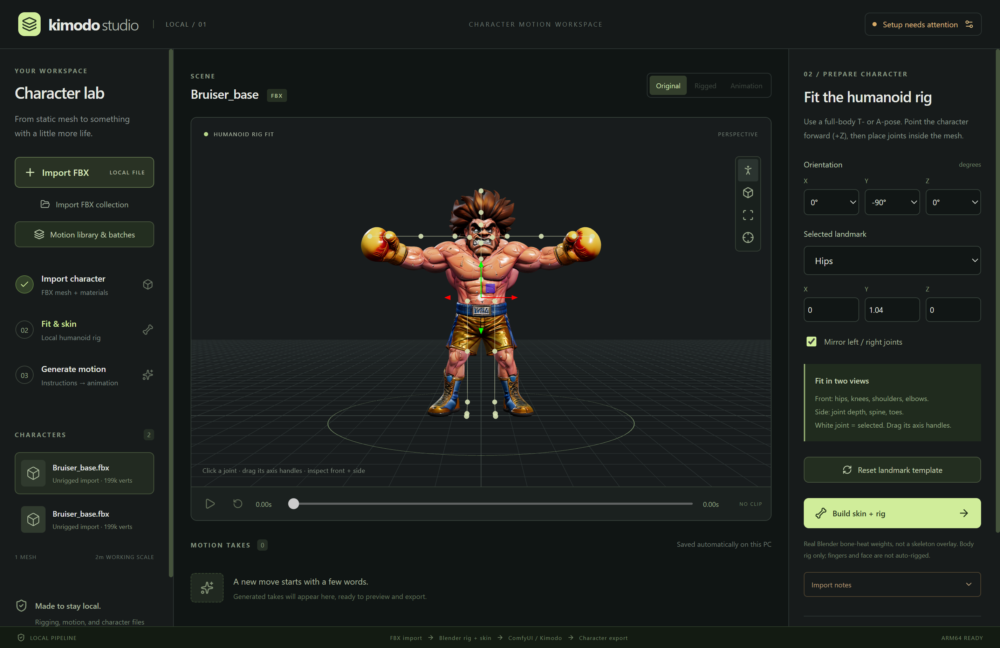
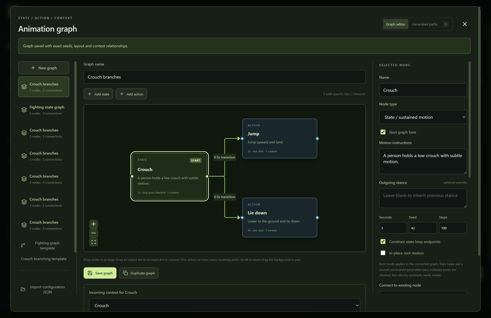

# Character Studio

**An AI-assisted video game character creation studio.** The goal is to help game developers turn character assets into animated, reusable characters through a local workflow for preparation, rigging, natural-language motion generation, visual animation graphs, and export.

The implementation combines **staged character design and existing humanoid FBX assets with AI-generated body motion**. Artists retain control over reference review, rig fitting, motion instructions, and the final exported character. Generated meshes are untextured geometry, not finished game assets.

Local Windows ARM64 desktop app with **Designer** and **Animator** workspaces. Designer turns a character brief or local reference image into a scene concept, a T-pose reference, and untextured 3D geometry. Animator imports humanoid meshes, fits and skins a body rig, generates Kimodo motion through ComfyUI, and exports the **animated character mesh**.

## Screenshots

### Character lab and guided rig fitting



Import a character, inspect its mesh, and adjust humanoid joint landmarks before building the skin and rig.

### Visual animation graphs



Arrange reusable states and actions, connect transitions, and edit motion instructions and generation settings. These screenshots predate the Character Studio rename and Designer workspace; they do not demonstrate successful AI inference or establish generated-motion quality. The sample character asset is not included in this repository.

## Launch

Open `release\CharacterStudio-win32-arm64\CharacterStudio.exe`, or run `Start-CharacterStudio.ps1`. The old `Start-KimodoStudio.ps1` launcher forwards to the new launcher for compatibility. Kimodo remains the name of the local motion-generation backend.

Keep the portable folder together; its executable depends on the included runtime files. Native Blender and the Python backend scripts are deliberately unpacked rather than placed inside an Electron archive.

For development:

```powershell
npm install
npm run setup:blender
npm run dev
```

`npm run build` builds the app; `npm start` launches that build. `npm run package` creates the portable ARM64 application, including the isolated Blender runtime.

## Designer workflow

Switch to **Designer** in the top bar. The existing character lab remains in **Animator**; switching tabs preserves in-progress briefs, rig edits, and motion settings. These are two workspaces in one desktop app, not two competing inference services. Designer and Animator share one job slot to avoid GPU contention.

1. Open **Backend connections** and connect the existing local ComfyUI. In Designer, refresh **Local model profiles**, choose installed weights, and **Save model choices**. Designer does not require Kimodo's Llama encoder. The shared backend dialog still reports Animator-specific readiness separately.
2. Choose **Text description** or **Reference image** (local PNG/JPEG/WebP, up to 20 MB and 32 megapixels). Supply **Character & scenario** and **Art style** separately. For example: a Brazilian MMA fighter raised in the jungles of Brazil, rendered as a vibrant 90s game character with exaggerated upper-body muscles.
3. Enter an optional title, or select an already-installed local Ollama instruction model for automatic naming. Ollama is restricted to `http://127.0.0.1:11434`, runs the naming model on CPU, and unloads it afterward. Cloud-backed models are rejected. Without a title or an available local naming model, generation stops with instructions rather than inventing a placeholder title.
4. **Create character concept** generates a character-and-scene image using both descriptions. Image input is actual reference conditioning, not an ignored attachment. Select an installed **IP-Adapter Plus** and its matching **CLIP Vision** model to carry visual identity without copying scene pixels; otherwise the workflow uses basic img2img. **Reference influence** controls conditioning strength.
5. Review the scene, then **Use scene & generate T-pose**. A separate workflow consumes the completed scene and a generated OpenPose T-pose guide. **Local BiRefNet background removal is mandatory**, preserving character colors and saving a transparent cutout. Opaque/empty masks, excessive foreground coverage and cutouts touching the image border are rejected. The checkerboard is preview-only. Review identity, straight horizontal arms, hands/feet, and any scenery accidentally attached to the character before continuing. Img2img and pose conditioning do not guarantee identity or anatomical correctness; use **Use brief for variation** when a stage needs revision. Older opaque T-poses have a **Remove T-pose background** action that preserves the original image.
6. **Use T-pose & generate 3D** revalidates the transparent cutout and composites only its foreground onto pure white before native, local Hunyuan3D image-to-geometry conditioning. Original scenery and hidden RGB under transparent pixels are not used as background. Preview or save the GLB, then **Send to Animator** to import the generated mesh through Blender and fit/skin it using the existing character lab. This preserves the original generated GLB. Reopening the same design selects its existing Animator character instead of duplicating it.

### Offline models and memory profiles

Models must already be installed before going offline. Studio neither downloads models nor installs custom nodes/packages while generating. Checkpoint and ControlNet selectors come from the connected ComfyUI, not a fictitious installed-model list. Model licenses, GPU architecture, drivers, precision, and available system RAM still matter.

| Stage | Supported profile | Estimated available GPU budget | Setup |
|---|---|---|---|
| Scene and T-pose | SD 1.5 / DreamShaper 8, 512px | 4 GB | Complete checkpoint in `ComfyUI\models\checkpoints`; matching SD 1.5 OpenPose in `models\controlnet` |
| Scene and T-pose | SDXL, 1024px | 8 GB | Complete SDXL checkpoint; matching SDXL OpenPose ControlNet |
| Required T-pose cleanup | Native BiRefNet foreground segmentation | Add 2 GB to image-stage budget | `birefnet.safetensors` in `models\background_removal` |
| 3D geometry | Hunyuan3D 2mini, 128 decode resolution | 6 GB | Native single-view 2mini safetensors checkpoint |
| 3D geometry | Hunyuan3D 2, 256 decode resolution | 10 GB | Native single-view 2 safetensors checkpoint |
| Optional title | Small local instruction model, e.g. Qwen 2.5 3B | CPU / system RAM | Already installed in local Ollama; not Kimodo's trained motion encoder |

These are conservative working budgets, not guaranteed minimum requirements or benchmarks. IP-Adapter conditioning adds an estimated 2 GB to image-stage budgets; it requires separately installed compatible `ComfyUI_IPAdapter_plus` nodes, weights in `models\ipadapter`, and vision weights in `models\clip_vision`. Each stage checks **currently free memory on one GPU**, not summed VRAM or nominal capacity. No CPU-only image/3D fallback is claimed. Lower-memory machines can create references even when the 3D stage is unavailable. Image and 3D models are selected independently. SD 1.5 and SDXL ControlNets and adapters are not interchangeable. Choose weights matching the selected family; filename lists alone cannot establish architecture compatibility.

Use the [official native Hunyuan3D setup](https://docs.comfy.org/tutorials/3d/hunyuan3D-2). This integration supports single-view Hunyuan3D 2 and 2mini, **not** turbo, multiview or 2.1 sampling profiles. Keep descriptive checkpoint names containing `hunyuan3d` (and `mini` for 2mini), so incompatible profiles are not accidentally selected. Do not select cloud/API Tripo or Hunyuan image nodes.

Background removal uses [Comfy-Org's native BiRefNet weights](https://huggingface.co/Comfy-Org/BiRefNet), also listed in the official `utility_birefnet_remove_background` workflow. Download the approximately 424 MiB safetensors separately, select it after refreshing Designer models, and all subsequent cutout processing is local/offline. A missing segmentation model blocks T-pose completion, not scene generation.

The Designer image pipeline has been exercised with local DreamShaper 8, SD 1.5 OpenPose, IP-Adapter Plus and BiRefNet. It produced a transparent T-pose cutout, but clothing and identity can still drift from the scene reference. Actual Hunyuan3D generation remains unverified here because its weights are not installed; automatic naming likewise requires a separately installed local Ollama model.

**Scope:** native Hunyuan3D produces **untextured, unrigged geometry**. The reference's colors are not baked onto the mesh. Texture synthesis, retopology, fingers/faces, guaranteed T-pose accuracy, and production-ready game assets are not claimed. Review and potentially repair the mesh before guided humanoid rigging.

Designs, reference copies, settings snapshots, and API workflow JSON live under `%APPDATA%\KimodoStudio\designs` with an independent `designer.json` index. Each stage publishes only a validated output from its own completed ComfyUI history entry. Cancellation targets only that prompt; restart marks interrupted stages failed while keeping earlier completed references. Failed stages can be retried after fixing setup, and completed stages cannot be overwritten. Model choices can be corrected for an unfinished stage; completed image stages retain their original image model family.

## Animator workflow

1. **Import FBX.** A copy of the original is preserved. Geometry/materials are converted locally with Blender; embedded textures are kept. Working copies are normalized to two meters in height. The camera starts facing the character. T-pose orientation is estimated from shoulders and feet; review the facing direction when FBX axes differ.
2. **Fit & skin.** Full-body, upright T-poses are the expected input; a clear A-pose can also be fitted. Adjust orientation and joint positions in both front and side views. Click a landmark and drag its axis handles, or edit XYZ coordinates. Symmetric fitting is enabled by default. Save the fit, then **Build skin + rig**.
3. **Connect local ComfyUI.** Open Backend connections. Default backend folder is `%LOCALAPPDATA%\ComfyUI`, API `http://127.0.0.1:8189`. The app can start this backend using its existing venv; it does not replace PyTorch or Transformers. For a ComfyUI already running elsewhere, select its actual port and output directory.
4. **Describe motion** and generate. Periods separate motion segments; duration applies to each segment. Jobs display progress and persist across restarts. Cancel targets only the app's prompt, never the global ComfyUI queue.
5. **Preview and export.** Completed clips support play/pause, scrubbing, orbit, zoom, and wireframe. Download animated GLB, animated FBX, or editable Blender scene. BVH/NPZ are separately labeled **motion-only** data. Partial/failed jobs never expose completed-character downloads.

## Local Llama, not remote inference

Kimodo uses a trained **Llama 3 8B + LLM2Vec** text encoder with its MNTP and supervised adapters. Inference happens on this computer. Hugging Face supplies the initial model downloads; it is not an inference endpoint.

Studio starts ComfyUI with `TEXT_ENCODER_MODE=local` and `TEXT_ENCODER=llm2vec`. If you start ComfyUI separately, set those variables in its process as well. The app does not change an already running backend's configuration.

### First-time model access

Open the top-right **Backend connections** button (it may display **Setup needs attention**), then **Model access & local setup**. The guide is always available, and expands automatically when the Llama check is blocked.

1. Sign in at <https://huggingface.co/meta-llama/Meta-Llama-3-8B-Instruct>. On **Model card**, find the license panel headed **You need to agree to share your Hugging Face information to access this model**. Click the wide **Expand to review and access** button beneath the license text. Review the terms/data-sharing notice, fill out the form, and submit only if you agree. Neither **Use this model** nor a paid inference provider is needed. Use this exact model, not the suggested Llama 3.1 upgrade.
2. Wait until the model page shows access is granted. Browser login and a pending request are not approval. The model owner handles approval.
3. Sign in locally with the same account using the existing ComfyUI environment. The in-app guide displays the exact PowerShell command for your **saved** backend folder; with the default path:

   ```powershell
   & "$env:LOCALAPPDATA\ComfyUI\venv\Scripts\hf.exe" auth login
   & "$env:LOCALAPPDATA\ComfyUI\venv\Scripts\hf.exe" auth whoami
   ```

   Choose browser sign-in if offered. If prompted for a token, create a **read** token at <https://huggingface.co/settings/tokens>; fine-grained tokens must permit reading the approved gated model. Enter it only in the CLI's secure prompt, not in command arguments, Studio, or chat. Studio does not collect credentials. Already signed in correctly? Skip login. To switch accounts, append `--force` to `auth login`. Do not reinstall/downgrade ComfyUI packages just to sign in.
4. Refresh the app's readiness checks, start local ComfyUI if needed, and generate. The first run downloads many GB of encoder weights/adapters; allow enough disk space and download time. Inference remains local.

**If approved but blocked:** verify the exact model, CLI account, and gated-model token permissions. `HF_TOKEN` in the launching environment overrides a saved login; check its configuration without exposing its value. Restart an already-running ComfyUI after changing authentication. Readiness distinguishes absent credentials, rejected login, denied download permissions, and network/service failures.

**Original encoder limitation:** the Llama full-pipeline attempt was blocked by the model-download access check. The experimental LFM path has since produced a real learned walk with skinned character exports; this does not demonstrate Llama authorization or equivalent motion quality.

### Alternatives

An already-authorized installation in the Hugging Face cache used by ComfyUI can reuse its weights without a new access request. It also needs the tokenizer, configuration, and both LLM2Vec adapters. The app does not currently offer an arbitrary local-model-folder selector, and cached base weights alone are not a guarantee of a complete offline installation.

vLLM is **not a drop-in replacement**: a generic chat/embedding model does not reproduce the checkpoint's trained LLM2Vec conditioning, and an inference server does not eliminate the need for authorized weights. [Official vLLM requires Linux rather than native Windows](https://docs.vllm.ai/en/stable/getting_started/installation/gpu/). Studio instead reuses the working native ARM64 PyTorch/CUDA environment.

Studio now includes an **experimental ungated LFM bridge** that keeps Kimodo and replaces only text conditioning. The original Llama/LLM2Vec option remains the default for existing workspaces. Generic embeddings are still not a model-name substitution: the bridge specifically maps LFM document embeddings into Kimodo's trained LLM2Vec space. See [Kimodo's official installation requirements](https://research.nvidia.com/labs/sil/projects/kimodo/docs/getting_started/installation.html) and the [LLM2Vec adapter's base-model declaration](https://huggingface.co/McGill-NLP/LLM2Vec-Meta-Llama-3-8B-Instruct-mntp/blob/main/adapter_config.json).

### Experimental LFM setup (no Llama approval)

From the source repository, using the existing ComfyUI environment:

```powershell
.\scripts\setup-lfm.ps1
# For a different backend:
.\scripts\setup-lfm.ps1 -ComfyRoot 'C:\path\to\ComfyUI'
```

The script downloads approximately 0.8 GB of public assets: [LiquidAI/LFM2.5-Embedding-350M](https://huggingface.co/LiquidAI/LFM2.5-Embedding-350M) and the community [LFM-to-Kimodo v2 bridge](https://huggingface.co/adriandj3/LFM2.5-to-Llama8B-LLM2Vec-Kimodo). No Hugging Face login or Meta approval is required. Revisions are pinned, weights/checksums are verified, and upstream model/bridge licenses are downloaded with the assets. It installs only Studio's `studio_kimodo_lfm` custom node; it does not replace ComfyUI packages or edit upstream Kimodo. Assets stay in the local Hugging Face cache, outside Git.

Restart ComfyUI, choose **LFM bridge (experimental, no access approval)** under **Backend connections > Kimodo text encoder**, save settings, and refresh readiness. Portable users need this one-time setup from the source checkout as well. The selected encoder applies to node clips, state loops, branches, and transitions. Jobs, batch snapshots and export manifests record the encoder; rerunning a saved batch requires selecting its original encoder (legacy batches retain Llama). Switching back to the original option restores the existing Llama workflow; there is no silent fallback from LFM to Llama or hosted inference.

The selector displays the detected GPU name and currently free/total memory. It recommends the smaller LFM bridge below **24 GiB free**, and the original Llama encoder with more headroom at or above that budget. This is conservative guidance, **not a measured minimum or a guarantee**. Download sizes (~0.7 GB versus ~16 GB) are not peak memory requirements: LFM uses float32, and Kimodo, duration, other models and shared/unified memory affect actual usage. With less than 4 GiB free, the UI warns that even LFM may be tight. Missing GPU information leaves the choice manual. Refresh readiness to update the reading; recommendations never silently change the saved encoder.

**Quality and compatibility:** the bridge approximates LLM2Vec embeddings; it does not retrain Kimodo or establish equal motion quality. Its author reports that fine details such as handedness can drift and that v2 lacks new motion-quality testing. Review prompts, stance, feet and joins before production use. Existing pose constraints, seam checks and skinned export validation remain enabled. The adapter uses float32 document/CLS embeddings, bidirectional attention, historical unmasked convolution padding, and no source-vector normalization. Bidirectional changes are instance-local rather than the upstream encoder's global Transformers patches. The installed Windows ARM64 Transformers environment differs from the author's calibrated versions; no packages are downgraded to match them.

**Licensing:** the bridge is Apache-2.0, but LFM is under the **LFM Open License v1.0**, including its $10M annual-revenue commercial-use limitation. It is not unrestricted MIT/Apache licensing. Kimodo's own terms remain applicable.

**Observed branch limitation:** a learned walk-to-punch branch failed the existing endpoint checks at both 25 and 100 denoising steps (about 2.46m root mismatch and 27-30 degrees maximum body rotation error). The app correctly refused a completed continuous-path export. This experiment does not establish whether the cause is encoder approximation or existing Kimodo constraint behavior; constrained graphs/loops are not validated for production with LFM.

The real-inference harness below requires the user-supplied `artifacts\Bruiser_base.fbx`, native Blender, and a running ComfyUI with the LFM node. It creates a fresh artifact workspace, generates independent walk/punch clips, and validates skinned exports. Optional branch validation retains the strict endpoint checks and exits with an error when they fail. It does not claim visually equivalent motion quality:

```powershell
node --import tsx scripts\lfm-integration.ts
# Optional alternate local API port:
node --import tsx scripts\lfm-integration.ts http://127.0.0.1:8190
# Optional constrained branch experiment (currently observed to fail endpoint checks):
node --import tsx scripts\lfm-integration.ts http://127.0.0.1:8190 --branch
```

## Visual animation graphs

Open **Motion library & batches**, then choose **Fighting graph template**. It contains a fighting idle state, a low crouch state, and **one shared Right hook action** with both `idle -> punch` and `idle -> crouch -> punch` connections. Select Punch and use **Incoming context** to inspect the two paths and their inherited stances.

Drag nodes to arrange the graph; drag an output dot to an input dot to connect nodes. Select a node to edit its instructions, duration, seed and state/action type. Select a connection to edit its transition duration. Mark the entry nodes with **Start graph here**. Positions and connections are saved with the configuration.

- **State nodes** describe a sustained posture, such as a fighting idle or crouch. They are generated in that posture and aligned to the preceding character's horizontal position and heading, without flattening the destination's root height.
- **Action nodes** are reusable instructions, such as "Throw a right hook punch." Each incoming path receives its own generated variant, conditioned on the actual previous endpoint and guided by the inherited stance. A standing punch is not reused as a crouched punch. Explicit instructions can change stance; the optional **Outgoing stance** clarifies the resulting posture for later nodes. The actual incoming pose takes precedence over textual posture guidance. There is no separate reasoning model inferring semantic postconditions; review model compliance and set an outgoing override when a change should propagate.
- **Connections** create separately generated transitions constrained at both endpoints. Zero seconds requires a direct pose match instead. Node clips, incoming transitions and complete paths have independent GLB/FBX/Blender exports and previews. Each part uses the same path-relative root origin.
- **State loops** use a second generation pass constrained to return to the initial pose. Endpoint root and body rotations are checked, but this does not guarantee velocity continuity, foot-contact quality or a visually seamless loop. Turning off the checkbox produces an ordinary non-looping state clip.
- **Pose continuity** is checked at every join: maximum 2cm root error and 5 degrees body-joint rotation error. Incorrect frame counts, mismatched endpoints or failed exports block the result instead of silently publishing disconnected motion. Duplicate boundary frames are removed from assembled paths. A transition into an action already starting at the previous endpoint may be a short hold.
- **Cycles** are finite: each path includes its first revisited node once, then stops. This exports a cycle traversal, not an endlessly growing queue or an in-engine state machine. Limits are 32 nodes, 64 connections, 64 path-specific variants per character and 60 seconds per path including transitions. Unreachable nodes must be connected or marked as starts.

Graph instructions are treated as one clip per node; punctuation does not create extra segments. Older configurations migrate without changing their prompts, seeds or period-separated segment durations, using direct-pose connections. Selecting a node type explicitly opts a legacy node into the new single-clip behavior.

## Repeatability and collections

Open **Motion library & batches**, or **Save this configuration** beside the current prompt.

- **Configurations** save exact instructions, duration, seed, denoising steps, in-place mode, a humanoid landmark fit, and a named motion graph. Save as copy for a variation, or import/export versioned JSON. Apply a prompt/settings preset to another FBX; optionally reuse its rig landmarks while preserving the new FBX's detected orientation.
- **Branches** can also start directly from a completed take in Character lab. Studio exports the actual parent's endpoint as a Kimodo `FullBodyConstraintSet` at child frame zero, including root location/height and joint rotations, and validates the join.
- **Collections** accept multiple FBX imports. Select up to 32 characters. Jobs run sequentially to avoid competing GPU allocations. Existing rigs are preserved. The optional saved-fit setting rigs unrigged characters; this assumes similar humanoid proportions and still requires visual review.
- **Identical motion** generates once per **path context**, including its transitions, and reuses the exact source motion across target characters, retargeting it to each rig. It never substitutes a different incoming path. **Variation** instead applies a deterministic seed offset (1, 100, or 1000) per character. The seed is `node seed + character index * offset`, modulo 2^32; transitions use the next seed. Seed variation changes the sampled performance, not a calibrated motion-intensity value.
- **Batch snapshots** preserve their configuration, target order, and effective seeds even if you edit the original preset. *Run same batch again* uses that immutable snapshot. New generations with the same seed are intended to be repeatable, but bitwise reproducibility across different model/software/hardware versions is not promised.
- **Save outputs** writes completed character files into a new batch folder, one character/motion directory each, with configuration and per-job manifests. Failed/blocked items are identified in the batch manifest and do not gain fake output files. Cancellation retains completed results; restart marks interrupted work blocked until explicitly rerun.

The branch constraint serialization, conversion to the real SOMA30 model skeleton, seam validation, and branch assembly are exercised without downloads. The graph integration harness uses clearly labeled analytic standing/crouching poses, loops and transitions on real Bruiser meshes. This verifies context isolation and real skinned exports, **not learned motion quality**. The separate LFM harness uses actual learned inference; constrained LFM branch attempts failed the strict endpoint checks.

## Backend and limitations

- Official **Blender 4.5.15 LTS ARM64** portable distribution, checksum-verified by `scripts\setup-blender.ps1`. Isolated under `.tools`; no CUDA auto-rigging packages are installed into ComfyUI.
- A real 22-bone humanoid body rig, Blender bone-heat skinning, maximum four normalized influences per vertex, and required body-bone/vertex-coverage checks. This is **guided rig fitting**, not an unvalidated universal AI auto-rigger. Fingers/faces, cloth, quadrupeds, and arbitrary poses are outside this version.
- SOMA-77 global rotations are converted from Y-up into Blender coordinates, corrected for the fitted target rest pose, and baked onto the skinned character. Root trajectory is scaled to the character; optional in-place mode removes horizontal root displacement. Fine finger motion is not transferred to the body-only rig.
- FBX export uses Blender, **not** the unavailable ARM64 Autodesk Python SDK.
- Foot contact cleanup is not installed. Foot sliding, extreme joint bends, or imperfect automatic weights can require manual cleanup. Playback looping is not a promise of a seamless looping animation.
- Skinning errors are actionable failures, not silent proximity-weight fallbacks. Repair intersecting/non-manifold meshes and refit joints if Blender cannot assign complete weights.
- The app's ComfyUI endpoint is restricted to loopback. No character upload service exists. Downloaded model files remain local. ComfyUI/custom nodes are trusted local software; separately started services remain responsible for their own configuration.

## Data and reproducibility

Workspace data continues to live in `%APPDATA%\KimodoStudio` for backward compatibility: `studio.json`, original FBX copies, packed working scenes, rigs, job logs, and completed outputs. Renaming the app does not move or reset existing work. Use **Open workspace files** in the app. Rig edits invalidate the old rig until rebuilt; old completed animation jobs remain immutable. On restart, interrupted jobs are marked failed rather than complete. `comfy-server.log` contains logs from the app-owned backend.

The actual supplied `Bruiser_base.fbx` has 198,581 vertices and no existing rig. The body backend is tested against this file, including native skinning, real vertex deformation, and GLB/FBX reimport. The fitted sample setup is in `tests\fixtures\bruiser-setup.json`.

**Analytic motion fixtures are tests, not generated clips.** `artifacts\bruiser-analytic-test` contains a clearly labeled analytic wave used to verify retargeting without gated weights. It is never inserted as a successful ComfyUI job. Actual learned LFM character outputs are kept separately in `artifacts\lfm-integration-*`; visual quality and constrained graph behavior remain limited as described above.

```powershell
npm test
npm run typecheck
npm run test:desktop
node scripts\designer-smoke.mjs
node scripts\designer-smoke.mjs --generate
node --import tsx scripts\validate-character.ts
node scripts\animation-smoke.mjs
node scripts\library-smoke.mjs
node scripts\graph-smoke.mjs
node scripts\graph-smoke.mjs --packaged
node scripts\packaged-smoke.mjs
node scripts\model-setup-smoke.mjs
& "$env:LOCALAPPDATA\ComfyUI\venv\Scripts\python.exe" tests\test_preflight.py
node --import tsx scripts\batch-integration.ts
node --import tsx scripts\graph-integration.ts
& "$env:LOCALAPPDATA\ComfyUI\venv\Scripts\python.exe" tests\test_branch.py "$env:LOCALAPPDATA\ComfyUI\custom_nodes\ComfyUI-Kimodo\kimodo"
node --import tsx scripts\check-local-backends.ts
```

The FBX integration scripts expect the user-supplied copy at `artifacts\Bruiser_base.fbx`; no character asset is fetched from third parties. Blender's redistribution/license files remain bundled with its runtime.

The Designer smoke command without flags checks layout and the existing local model list. `--generate` starts a temporary app-owned ComfyUI on a free loopback port, uses the installed DreamShaper/OpenPose/IP-Adapter/BiRefNet weights, and runs real image generation without restarting the user's service. It expects absent 3D weights to block the final stage rather than publish a fake mesh. `--packaged` runs the same check against the portable Character Studio executable.
