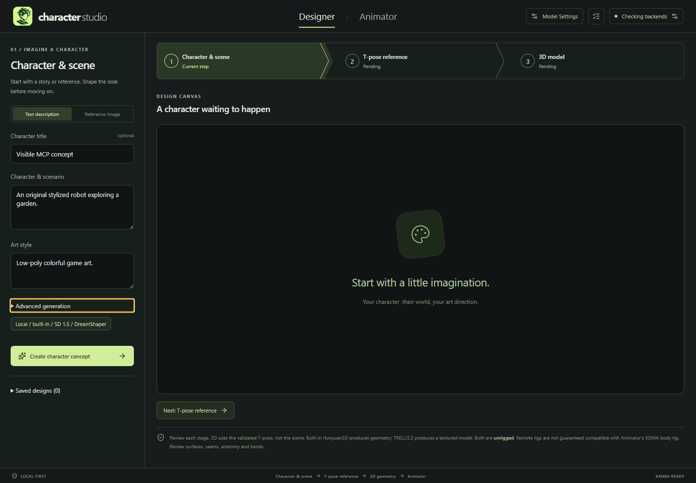
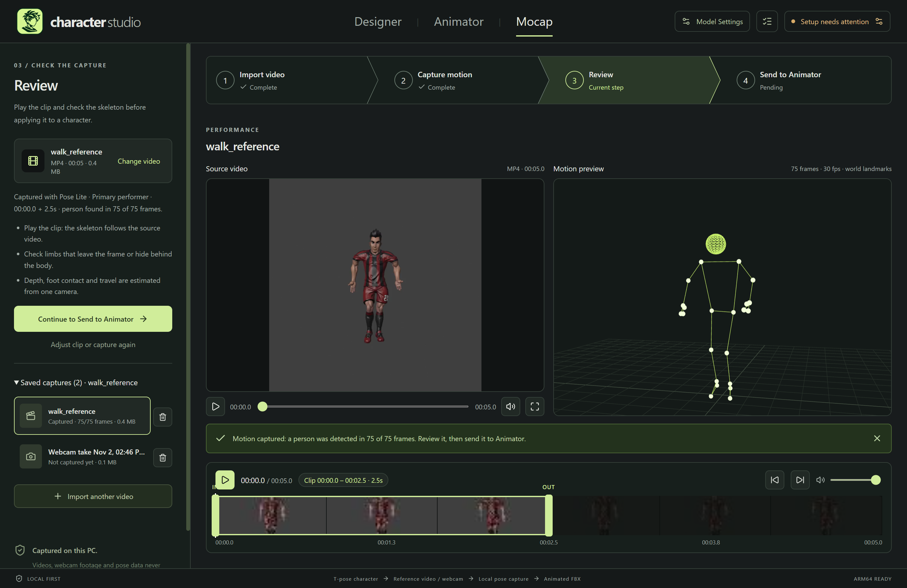

# Character Studio

## Imagine the character. Direct the performance.

**An AI-assisted character creation studio for game developers who want to spend more time building worlds.**

Turn a brief into a textured 3D character. Bring an existing humanoid to life with motion described in plain language. Capture a performance from video. Shape, review and export your work in one local-first desktop studio.

**Three workspaces. One creative pipeline. Your direction at every step.**

[Get started](#getting-started) | [Features](#features-at-a-glance) | [Advanced features](#advanced-features) | [Future directions](#future-directions) | [Full guide](GUIDE.md)


*From reference to dimension: an actual local TRELLIS.2 result with embedded textures. Historical UI; the model is unrigged and still needs review, fitting and skinning.*

## Features at a glance

| Create your cast | Bring it to life |
|---|---|
| **Design from words or images.** Build a scene concept, isolate a T-pose reference and generate a 3D mesh, reviewing each stage before moving on. | **Direct motion in plain language.** Describe a walk, wave or action; adjust duration and seed, then preview the take on your character. |
| **Generate textured 3D.** Choose local TRELLIS.2 for embedded color/material maps, or Hunyuan3D for lower-memory, geometry-only output. | **Capture a performance.** Import video or record a webcam take, estimate body motion locally on the CPU and bake it onto a rigged character. |
| **Bring what you already have.** Start from an existing T-pose, import a self-contained GLB into Designer, or bring humanoid FBX assets straight into Animator. | **Fit the rig your way.** Start with mesh-based landmark fitting, refine joints with mirrored controls, and build a Blender-skinned humanoid rig. |
| **Keep creative control.** Review references, make new variations and retain originals rather than overwriting earlier work. | **Export the character, not just the bones.** Save animated skinned GLB and FBX, plus an editable Blender scene. Motion-only BVH/NPZ stay clearly separate. |

### Designer: give your idea a body

**Brief or reference image -> scene concept -> transparent T-pose -> 3D model.**

Explore a look, check the pose, then build the mesh. Skip the earlier stages when you already have a cutout or GLB. Keep generation options close to the current step, with detailed model configuration tucked away until you need it.



*Current workspace layout, captured in an isolated desktop/MCP test workspace before generation. This is the actual app, not a design mockup.*

### Animator: turn a static asset into a performance

**Import -> fit and skin -> generate motion -> review and export.**

Bring in a humanoid FBX or send over a Designer mesh. Refine the rig, describe the movement and review it with playback, scrubbing and a full 3D viewport. Save configurations to explore another take without losing the one you liked.


*Actual learned walking take using the experimental local LFM bridge, with skinned-character exports. Historical UI; the imported sample asset is not included. A still frame is not a motion-quality benchmark.*

### Mocap: make a reference performance your starting point

**Video or webcam -> local body capture -> side-by-side review -> animated character.**

Trim the clip, capture with MediaPipe Pose on the CPU and compare the estimated skeleton with the source video. Apply smoothing, mirror the performance or choose upper-body-only tracking before sending the result to Animator. Local capture needs no ComfyUI or GPU; character rigging and export use Blender.



*Actual 75-frame local capture from a Blender-rendered walking reference, not live-action footage. Single-camera depth and foot contact are estimated; capture is body-only and in place.*

## Advanced features

**Go beyond a single character and a single take.**

| Feature | Creative leverage |
|---|---|
| **Visual animation graphs** | Connect states, reusable actions, transitions and pose-constrained loops. Each incoming path carries its actual pose context, so a standing action is not silently reused for a crouched entry. [Graph workflow](GUIDE.md#visual-animation-graphs) |
| **Hand posing and rig detail** | Choose wrist-only or basic three-chain hands per side. Pose wrists, thumb, index and grouped fingers; key hand changes over body motion or bake a fixed grip into a separate character. [Hand controls](GUIDE.md#hand-pose-and-rig-detail) |
| **Collections and batch generation** | Apply configurations across FBX collections, reuse identical motion per path context or explore deterministic seed variations. Immutable batch snapshots preserve the original setup for reruns. [Batches](GUIDE.md#repeatability-and-collections) |
| **Your models, your routes** | Open **Model Settings** for hardware-aware local profiles, custom checkpoints and mapped ComfyUI workflows. Route individual stages to explicitly approved remote ComfyUI servers or Studio API gateways. [Providers](GUIDE.md#model-and-workflow-providers) |
| **Optional paid Tripo integration** | Use your own API key and credits for hosted images, mesh generation with triangle budgets/Smart low-poly, and separate PBR or rigged-GLB variations. Paid end-to-end interoperability is not yet verified. [Tripo setup](GUIDE.md#tripo-paid-api) |
| **Visible AI-agent control** | Opt in to local MCP control so a trusted agent operates the actual desktop controls, previews and dialogs while you watch. Default off, authenticated and loopback-only, with immediate in-app revocation. [MCP setup and trust](GUIDE.md#desktop-mcp-control) |
| **Local-first, with a record of the work** | Keep original assets, completed takes and workspace history on this PC. Outputs retain provider/model/workflow provenance; remote stages ask for approval before transmitting prompts or assets. [Data and provenance](GUIDE.md#data-and-reproducibility) |

Graph authoring and endpoint validation are implemented, but seamless learned graph motion is not guaranteed. Experimental LFM constrained-branch attempts have failed the strict join checks; failed paths are not presented as complete.

## Basic requirements

**Start with the workflow you need. You do not need every model to use every workspace.**

| Area | What to plan for |
|---|---|
| **Desktop** | Windows ARM64 is the locally exercised development workflow. Build targets also include Windows x64, Linux x64 and macOS Apple Silicon; packaging does not establish full workflow compatibility on those platforms. |
| **System memory** | Target **32 GB RAM minimum**, ideally **64 GB with CUDA support** for local AI work. These are planning targets, not a guarantee that every model fits; system RAM does not replace a stage's free-GPU-memory requirement. |
| **Local AI generation** | A compatible GPU/driver stack, separately configured ComfyUI, required custom nodes and the selected weights. Conservative free-GPU-memory budgets range from about **4 GB** for basic scenes to **24 GB** for local textured 3D; T-pose editing plus cleanup budgets about **16 GB**. [Model-by-model requirements](GUIDE.md#offline-models-and-memory-profiles) |
| **Rigging and character export** | Local Blender; the setup command installs an isolated, checksum-verified runtime and portable builds include it. Motion processing also needs the configured Python/Kimodo environment, even with remote inference. |
| **Video capture** | CPU-based MediaPipe Pose with a one-time **5.5 MB Pose Lite** or **9 MB Pose Full** download. A webcam is optional. Blender is needed to rig and export the animated character. |
| **Storage and connectivity** | Allow space for Blender, multi-GB weights, original assets and outputs. Initial setup needs internet; installed local workflows can run offline. Remote routes need connectivity and any provider account/credits, but not local inference weights or local VRAM. |
| **Running from source** | Git and **Node.js 24 with npm**, matching CI. Models, ComfyUI and GPU drivers are not installed by `npm install`. |

## Getting started

### Run from source

In PowerShell:

```powershell
git clone https://github.com/rwrife/CharacterStudio.git
Set-Location CharacterStudio
npm install
npm run setup:blender
npm run dev
```

Already have the repository? Run the three `npm` commands from its root.

On first launch, **Setup checklist** shows what is ready and what your chosen workflow still needs. Configure the local backend under **Backend connections** (normally `%LOCALAPPDATA%\ComfyUI`, API `http://127.0.0.1:8189`), then choose the stage's models in **Model Settings**. Supported Designer weights have explicit download actions; the checklist does not install ComfyUI, GPU drivers or its custom nodes.

**Pick a first project:** open **Designer** to create a concept or import a T-pose/GLB; open **Animator** to import an upright humanoid FBX; or open **Mocap** to import a video and download Pose Lite for CPU capture. Complete the selected workflow's prerequisites before generation or export.

For local text-to-motion, configure ComfyUI-Kimodo and its trained encoder. The original Llama/LLM2Vec encoder requires approved model access; the optional **experimental LFM bridge** has separate setup, licensing and quality tradeoffs. [Motion model setup](GUIDE.md#local-llama-not-remote-inference) | [LFM setup](GUIDE.md#experimental-lfm-setup-no-llama-approval)

### Build or use a portable app

`npm run build` builds the desktop app; `npm start` opens that build. `npm run package` creates a portable app for the current supported OS/architecture with the isolated Blender runtime.

For Windows ARM64, open `release\CharacterStudio-win32-arm64\CharacterStudio.exe` after packaging, or use `Start-CharacterStudio.ps1`. Keep the portable folder intact. Published archives, when available, are on [Releases](https://github.com/rwrife/CharacterStudio/releases); successful CI builds also provide temporary workflow artifacts.

Windows/macOS builds are unsigned, and macOS builds are not notarized. Portable apps do not bundle AI weights or ComfyUI and are not installers or automatic updaters. [Platform and release details](GUIDE.md#automated-builds-and-releases)

## Future directions

**The ambition: a richer character pipeline, without taking the artist out of the loop.**

| Future capability | Where it stands |
|---|---|
| **AI part segmentation** | Reserved provider extension point for more structured character understanding; not an implemented workflow. |
| **Learned landmark detection** | Future model-backed fitting. Today's automatic landmark placement is a geometric heuristic, with manual review and adjustment. |
| **Secondary motion and cloth analysis** | Reserved extension points, not shipped simulation or cloth-generation features. |
| **Individual-finger rig detail** | Future option; today's configurable hands support wrist-only or basic three-chain rigs, not independent control of every finger. |

These are directions, not release commitments or features available today.

## Creative acceleration, not a one-click production guarantee

Character Studio helps you explore and assemble character assets; **generated meshes are not automatically finished game assets**. Expect to review topology, anatomy, textures, skinning, feet and motion before engine integration. Guided rigging targets upright T-/A-pose humanoids, not arbitrary creatures or poses. Remote rigged GLBs are not guaranteed compatible with Animator's SOMA rig.

Observed local runs include textured Designer meshes, learned LFM motion and skinned exports; they do not prove every model, provider or graph works end to end. Review upstream model, runtime and provider licenses before commercial use or redistribution.

**Ready to build your cast?** Start with [getting started](#getting-started), then use the [full guide](GUIDE.md) for workflow instructions, model downloads, troubleshooting, API contracts and developer checks. The guide is also [available online](https://github.com/rwrife/CharacterStudio/blob/main/GUIDE.md) for portable-app readers.
